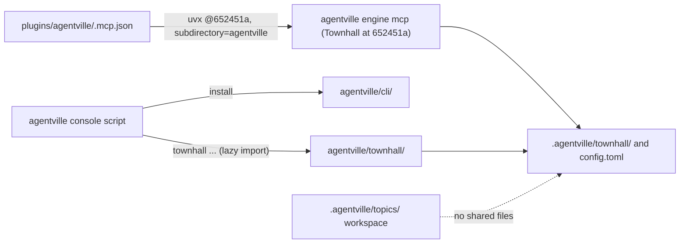

This PR adds Townhall to the root `agentville` package in `agentville/townhall/`, runs it as `agentville townhall ...`, and starts its MCP server from the plugin through a SHA-pinned `uvx` launch. It supersedes #13 and is synced with `main` after #21 merged.

Verdict: Review round 1 fixes pushed; re-review pending. Blocking items: 0. Decisions needed: 1.

## Decisions needed

No item blocks the merge. The owner's PR #20 comment raised four decisions; three are settled and one stays open.

| Question | Options | Agent default | Consequence if unanswered |
| --- | --- | --- | --- |
| Re-pin `.mcp.json` from `652451a` to a commit that holds `agentville/townhall/`? | Re-pin in the next release-preparation commit, or keep `652451a` until a later release | Undecided | The plugin keeps running Townhall as it was at `652451a`, with `subdirectory=agentville` and `agentville engine mcp`. |

Settled: (1) layout: Townhall lives in `agentville/townhall/`, done; (2) keep the shared `agentville` name: done, now one distribution; (3) merge: the owner merges manually. Detail is on the decisions page, linked in the Evidence index.

## Context

Townhall is a file-based board-and-ticket engine for agents. PR #13 added it in `agentville/`; `main` then took that folder for the installer CLI (#18). This branch merged `origin/main` again after #21 and moved Townhall into `agentville/townhall/`, with the inner board package at `agentville/townhall/board/`. There is now one `agentville` distribution: `agentville` alone is the installer CLI, and `agentville townhall ...` runs Townhall. This is a breaking rename: `agentville init` and `agentville engine` become `agentville townhall init` and `agentville townhall engine`. The plugin version is 0.11.0. Townhall's 9 dependencies are now core dependencies, so `uvx agentville install` pulls them; they are loaded lazily, only for `agentville townhall`. Townhall stays independent of `orchestrate` and of the `draft`, `plan` and `report` slots.

## Changes

| Task | Files | Behaviour change | Evidence id |
| --- | --- | --- | --- |
| Add the package (`652451a`) and pin the MCP server (`f5577f2`) | `agentville/`, `plugins/agentville/.mcp.json` | New CLI, 11 `townhall_*` MCP tools, viewer and Temporal workflows; plugin starts Townhall from `652451a` | run-1 |
| Sync with `main` after #21 (`3541038`) | `CLAUDE.md`, `README.md`, `plugin.json` | Keeps both sides | run-1 |
| Move into `agentville/townhall/` (`e674f0a`) | `agentville/townhall/`, `agentville/cli/app.py`, `pyproject.toml`, `uv.lock`, `tests/townhall/` | One distribution; `agentville townhall ...` subcommand; plugin 0.11.0 | run-1 |
| Fix two stale docs (review round 1) | `CLAUDE.md`, `agentville/townhall/README.md` | Docs only | gate, pytest |
| Describe the PR | `.agentville/pr/20/` | No runtime change | none |

The pinned launch in `.mcp.json`:

https://github.com/minhphamdonhat/Agentville/blob/{head-sha}/plugins/agentville/.mcp.json

Per-commit detail is on the changes page, linked in the Evidence index.

## Architecture changes

The plugin's `.mcp.json` still runs `uvx` at `652451a` with `subdirectory=agentville` and `agentville engine mcp`. At HEAD one `agentville` console script serves both parts: `agentville install` runs the installer in `agentville/cli/`, and `agentville townhall ...` imports `agentville/townhall/` only when called. The next re-pin uses the root package and `agentville townhall engine mcp`.

## Tests and evidence

The validator ran every check on Linux; evidence run-1 for this topic, `SHA256SUMS` hash `38014ab84263`.

| Check | Command | Result | Evidence hash |
| --- | --- | --- | --- |
| All tests | `uvx --from 'uv>=0.13.5' uv run --locked pytest -q` | 316 passed: 38 installer, 278 Townhall | `38014ab84263` |
| Help commands | `agentville --help`, `agentville townhall --help` | Pass | `38014ab84263` |
| Lint | `ruff check agentville tests` | Pass | `38014ab84263` |
| Build | `uv build` | Pass | `38014ab84263` |
| Verify block in `CLAUDE.md` | smith tests, `worker.md` diffs, variant check, scan | Pass | `38014ab84263` |
| Pre-publish gate | `scan.py ... --fail-on medium` | Pass | `38014ab84263` |

Not tested: the macOS and Windows CI jobs for the Townhall tests in `.github/workflows/publish.yml`, a live MCP launch from `.mcp.json`, and a live Temporal run. Commands are on the tests page.

## Risks, limits and rollback

The main risks are the breaking CLI rename, a heavier `uvx agentville install` now that Townhall's 9 dependencies are core, and a pin that still runs the pre-move server. To roll back the whole PR, revert its merge commit on `main` with `git revert -m 1 <merge-sha>`. Detail is on the risks page.

## Reviewer checklist

- [ ] `agentville townhall init` and `agentville townhall engine` as the new commands are acceptable as a breaking rename.
- [ ] Pulling Townhall's 9 dependencies into every `uvx agentville install` is acceptable.
- [ ] Keeping `652451a` in `.mcp.json` for now is acceptable until the re-pin is decided.
- [ ] The README's Townhall section reads clearly to a new user.

## Review verdicts

| Round | Verdict | Findings | Status |
| --- | --- | --- | --- |
| 1 | needs-changes | Two stale docs: `CLAUDE.md` Townhall section and `agentville/townhall/README.md` | Fixed in this push |
| 2 | Pending | none | Re-review next |

## Evidence index

Head: {head-sha}

| Evidence | Where |
| --- | --- |
| Decisions | [Decisions page](https://github.com/minhphamdonhat/Agentville/blob/{head-sha}/.agentville/pr/20/decisions.md) |
| Per-commit changes | [Changes page](https://github.com/minhphamdonhat/Agentville/blob/{head-sha}/.agentville/pr/20/changes.md) |
| Diagrams | [Architecture page](https://github.com/minhphamdonhat/Agentville/blob/{head-sha}/.agentville/pr/20/architecture.md) |
| Checks and reproduction | [Tests page](https://github.com/minhphamdonhat/Agentville/blob/{head-sha}/.agentville/pr/20/tests.md) |
| Risks and rollback | [Risks page](https://github.com/minhphamdonhat/Agentville/blob/{head-sha}/.agentville/pr/20/risks.md) |
| Validator evidence | Folder `.agentville/topics/agentville-pr20-sync-2026-10-25/evidence/run-1`, `SHA256SUMS` hash `38014ab84263` |

🤖 Generated with [Claude Code](https://claude.com/claude-code)
