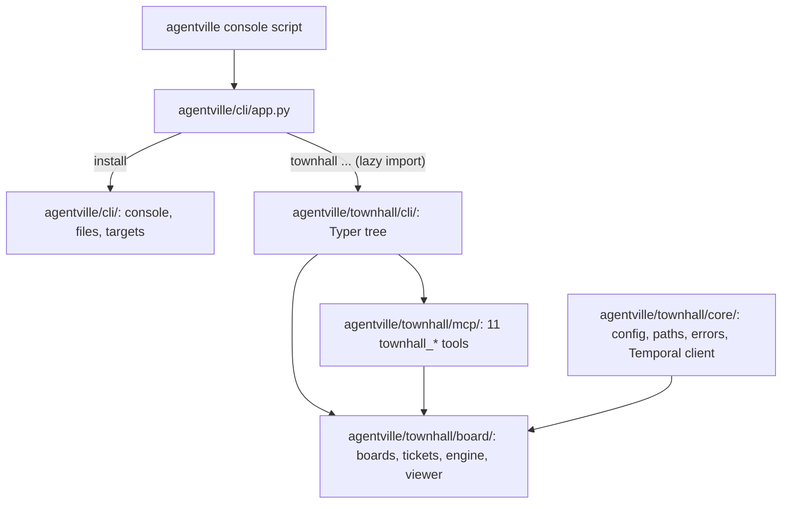
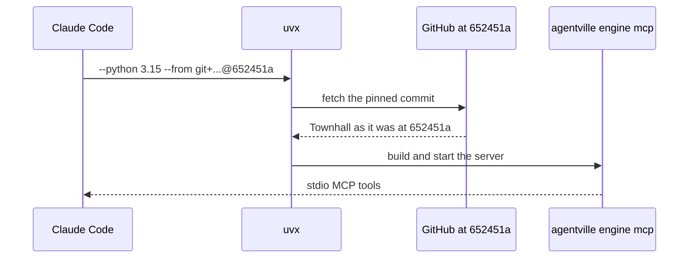

# Architecture changes

This page shows the package layout, the path from the plugin's `.mcp.json` to the running server, and how Townhall sits beside the installer and the workspace.

## Package layout

One `agentville` distribution at the repository root, with one `pyproject.toml` and `uv.lock`. The installer is in `agentville/cli/`; Townhall is in `agentville/townhall/`. `agentville/cli/app.py` imports Townhall only for `agentville townhall`, so `agentville install` never loads its dependencies.

In words: the console script runs `agentville/cli/app.py`. `agentville install` uses the installer modules; `agentville townhall ...` imports the Townhall Typer tree, which uses the board package, the MCP server and `core/`. `rag/` and `memory/` hold placeholders for later parts.

## MCP server launch path

In words: the pin still starts the pre-move server with `agentville engine mcp`. The next re-pin, to a commit that holds `agentville/townhall/`, drops `#subdirectory` and runs `agentville townhall engine mcp`; whether and when is undecided.

## Boundaries

Townhall does not back `orchestrate` or the `draft`, `plan` and `report` slots. The workspace writes only under `.agentville/topics/`; Townhall owns `.agentville/config.toml`, `.agentville/.gitignore` and `.agentville/townhall/`, created by `agentville townhall init`. Temporal is required: `agentville townhall engine worker` starts a local dev server on first use, and the MCP server never starts it.
