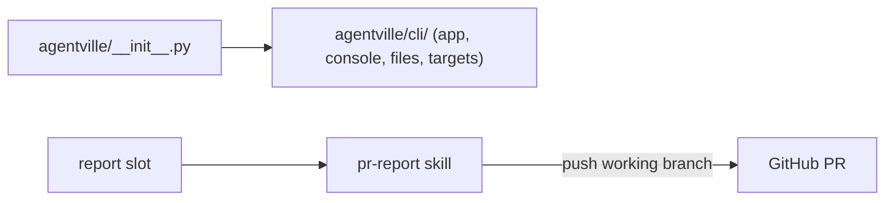

This PR moves the installer into `agentville/cli/`, adds the maintainer-only `pr-report` skill bound to the `report` slot, and drops commit and pull-request handling from the shipped agents and skills. Plugin 0.10.0 is a breaking release: the validator evidence field `commit:` is now `revision:`, validator and reviewer move to 3.0.0, and `voice` no longer covers commit or PR text.

Verdict: Ready to merge. Blocking items: 0. Decisions needed: 3.

## Decisions needed

| Question | Options | Agent default | Consequence if unanswered |
| --- | --- | --- | --- |
| State the `CLAUDE.md:109` pr-report push rule as an exception to the `CLAUDE.md:90` rule (commit, push and merge only when the user asks)? | Add the clause, or leave as is | Leave as is (`b3ac5b2`) | The two rules stay side by side with no stated precedence. |
| Keep orchestrate's step that combines parallel workers' worktrees? | Keep, or remove | Keep | The step stays in `orchestrate`. |
| Align the maintainer `.claude/skills/skill-smith` example `acme-pr-review` with the shipped copy's `acme-code-review`? | Align now, or later | Later | The two smith copies keep different example names. |

More on each in the [decisions page](https://github.com/minhphamdonhat/Agentville/blob/{head-sha}/.agentville/pr/21/decisions.md).

## Context

The installer package sat flat at the root of `agentville/`, which leaves no room for the later Townhall move into `agentville/townhall/`; this PR puts it under `agentville/cli/`. Agentville also had no way to publish a topic's report as a PR description, so `pr-report` fills the `report` slot for this repository and pushes its working branch and opens or updates its PR on its own. By the owner's decision, shipped agents and skills no longer handle commits or PRs. PS-06 is accepted for `pr-report`, with the `CLAUDE.md` push rule as the control. When PR #20 syncs from `main`, it moves to plugin 0.11.0.

## Changes

| Task | Files | Behaviour change | Evidence id |
| --- | --- | --- | --- |
| Restructure the installer (`ff1b6b0`) | `agentville/cli/`, `agentville/__main__.py`, `pyproject.toml`, `tests/cli/` | Entry point is `agentville.cli.app:main`; `agentville/__init__.py` stays at the package root | REQ-1 |
| Add `pr-report` (`1ad37dc`) | `.claude/skills/pr-report/`, `CLAUDE.md`, `README.md` | `report: Skill(pr-report)` binding; PRs rendered with a Verdict line and nine sections | REQ-3, REQ-5 |
| Accept PS-06 (`1111337`) | `CLAUDE.md` | Gate accepts `PS-06:*pr-report/SKILL.md` | REQ-2, REQ-3 |
| Drop commit and PR handling (`029e707`) | `plugins/agentville/agents/`, `plugins/agentville/skills/` | Shipped agents and skills no longer commit or open PRs; `commit:` renamed `revision:`; plugin 0.10.0 | REQ-4 |
| Bump validator and reviewer (`b3ac5b2`) | `validator.md`, `reviewer.md`, variants, `pr-report` 1.0.1, `CLAUDE.md` | Validator and reviewer at 3.0.0; push rule tidied | REQ-4 |

https://github.com/minhphamdonhat/Agentville/blob/b3ac5b27805783e03c3e68c76ed1423e5bb49aa9/CLAUDE.md#L109-L109

https://github.com/minhphamdonhat/Agentville/blob/b3ac5b27805783e03c3e68c76ed1423e5bb49aa9/.claude/skills/pr-report/SKILL.md#L14-L18

Every commit is on the [changes page](https://github.com/minhphamdonhat/Agentville/blob/{head-sha}/.agentville/pr/21/changes.md).

## Architecture changes

The installer modules now live in `agentville/cli/`, and `agentville/__init__.py` stays at the package root. The `report` slot binds to the repository-level `pr-report` skill, which pushes the working branch and writes the GitHub PR. See the [architecture page](https://github.com/minhphamdonhat/Agentville/blob/{head-sha}/.agentville/pr/21/architecture.md).

## Tests and evidence

| Check | Command | Result | Evidence hash |
| --- | --- | --- | --- |
| REQ-1 installer under `agentville/cli/` | `pytest`, help, `uv build` | 8 checks, pass | `fa54bd32cbf4` |
| REQ-2 Verify block and gate | `CLAUDE.md` Verify commands, `--fail-on medium` gate, `measure.py` | 23 checks, pass | `1d5bb5355a57` |
| REQ-3 pr-report skill rules | `checks.py` docs checks | 16 checks, pass | `22792e4dd2c7` |
| REQ-4 shipped files and 3.0.0 bumps | `checks.py` docs checks | 17 checks, pass | `4f686fef290a` |
| REQ-5 pr-report content | `checks5.py`, mutated-copy negatives | 23 checks, pass | `9beb3decc2b6` |
| REQ-6 worktree and merge base | `git` checks | 5 checks, pass | `ce59992a7c76` |

92 checks pass at `b3ac5b2` (run-3). Per-check detail is on the [tests page](https://github.com/minhphamdonhat/Agentville/blob/{head-sha}/.agentville/pr/21/tests.md).

Not tested or not verifiable: none, as run-3 records.

## Risks, limits and rollback

`agentville/__init__.py` stays at the package root and is a likely merge point with the later Townhall move into `agentville/townhall/`. Users of the validator's `commit:` field must read `revision:`. Roll back with `git revert -m 1 {merge-sha}` on `main`; the [risks page](https://github.com/minhphamdonhat/Agentville/blob/{head-sha}/.agentville/pr/21/risks.md) lists each risk.

## Reviewer checklist

- [ ] The breaking rename of `commit:` to `revision:` is acceptable for 0.10.0.
- [ ] `pr-report` pushing and opening PRs on its own fits how you want to work.
- [ ] Keeping `agentville/__init__.py` at the root is the right place before the Townhall move.
- [ ] The PS-06 acceptance with the `CLAUDE.md` push rule as the control is enough.

## Review verdicts

Round 1: blocked (evidence gap; validator bump too small), fixed in `b3ac5b2`. Round 2: pass-with-notes. Notes: `requirements.md` cites `CLAUDE.md:64`, not `:63`; `CLAUDE.md:109` does not say it is an exception to `CLAUDE.md:90`; the `pr-report` 1.0.1 patch bump is defensible.

## Evidence index

Head: {head-sha}

| Evidence | Where |
| --- | --- |
| Open decisions | [Decisions page](https://github.com/minhphamdonhat/Agentville/blob/{head-sha}/.agentville/pr/21/decisions.md) |
| Commits | [Changes page](https://github.com/minhphamdonhat/Agentville/blob/{head-sha}/.agentville/pr/21/changes.md) |
| Architecture | [Architecture page](https://github.com/minhphamdonhat/Agentville/blob/{head-sha}/.agentville/pr/21/architecture.md) |
| Checks and reproduction | [Tests page](https://github.com/minhphamdonhat/Agentville/blob/{head-sha}/.agentville/pr/21/tests.md) |
| Risks and rollback | [Risks page](https://github.com/minhphamdonhat/Agentville/blob/{head-sha}/.agentville/pr/21/risks.md) |
| Validator evidence | Folder `run-3` at `b3ac5b2`, `SHA256SUMS` hash `37622fd28912` |

🤖 Generated with [Claude Code](https://claude.com/claude-code)
