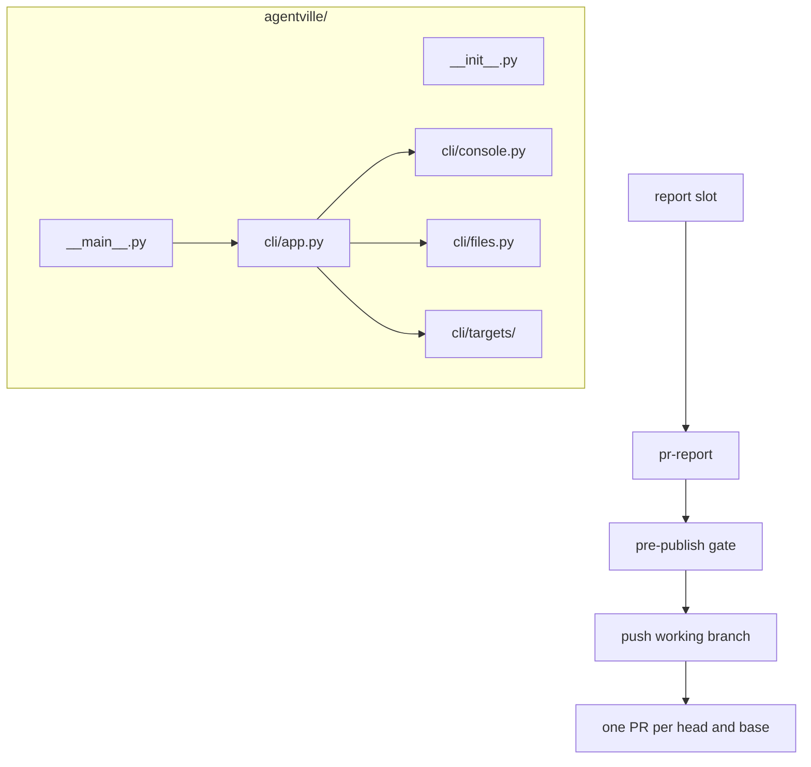

# Architecture changes

This page shows the installer package layout and the report path after this PR.

In words: the `agentville` package keeps `__init__.py` and `__main__.py` at its root and holds the installer in `agentville/cli/`. A topic's report goes through the `report` slot to `pr-report`, which runs the pre-publish gate, pushes the working branch and creates or updates the one PR for that branch and its base.

The later Townhall move into `agentville/townhall/` is likely to meet this layout at `agentville/__init__.py`.
