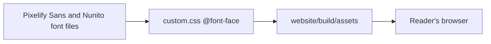

This PR restyles the documentation site in `website/` as a cosy 8-bit light theme with Pixelify Sans headings and Nunito body text. It replaces the earlier pixel-farm theme with day and night modes. It changes no page text, link or sidebar entry.

Verdict: Pending review. Blocking items: 0. Decisions needed: 2.

## Decisions needed

| Question | Options | Agent default | Consequence if unanswered |
| --- | --- | --- | --- |
| R8: may syntax colours in code blocks be tints of the palette? Validation run-2 rejected it: all Prism tokens are at least 7.36:1, but 7 of 10 are lighter tints, not exact palette hexes. | Allow tints, or map every token to an exact palette colour | Allow tints (not changed in this PR) | R8 stays rejected; code colours keep 7 tints. |
| R5: should the hero keep the full wordmark above the isometric house (the spec and approved mockup), or switch to the letters crop? Validation run-1 failed R5 because the hero shows two scenes. | Keep the full wordmark, or switch to the letters crop | Keep the full wordmark | The hero keeps both the wordmark art and the house. |

## Context

The site used a pixel-farm theme with Press Start 2P and VT323. This PR rebuilds it as one light theme: cream, wood, roof red, leaf green and sun yellow, with dark brown text. Headings use Pixelify Sans and body text uses Nunito, both self-hosted. The navbar shows the wordmark (letters crop), the hero shows the wordmark and an isometric house, and the favicon is a small house. The docs-site skill is now 1.5.0.

## Changes

| Task | Files | Behaviour change | Evidence id |
| --- | --- | --- | --- |
| Rebuild theme as cosy 8-bit light design (`f846854`) | `website/` theme, home page, fonts, images, favicon; `.claude/skills/docs-site/SKILL.md` | Light theme only; Pixelify Sans and Nunito replace Press Start 2P and VT323; wordmark in navbar and hero; isometric house hero; house favicon.png | Run-1 R1 to R10 |
| Remove unused favicon.svg (`26a3698`) | `website/static/img/favicon.svg` | No visible change | Run-1 |
| Footer hover contrast and palette code theme (`a59ca7b`) | `website/src/css/custom.css`, Prism theme | Footer hover at 5.51:1 or more; code blocks use palette-based colours | Run-2 R3, R8, R9 |
| Refresh PR pages and screenshots | `.agentville/pr/28/` | No runtime change; old-theme screenshots replaced | n/a |

## Architecture changes

The Pixelify Sans and Nunito files are bundled into the site's own assets. The browser loads them from the site, with no request to Google Fonts or another CDN.

## Tests and evidence

| Check | Command | Result | Evidence hash |
| --- | --- | --- | --- |
| Run-1 validation at `26a3698` | validator, 10 requirements | 7 of 10 pass; R3 footer hover 3.27:1, R5 hero shows two scenes and R8 Dracula code colours fail | `c83e164be079` |
| Run-2 R3 footer contrast at `a59ca7b` | contrast scan, 13 pages including hover | pass, minimum 5.51:1 | `93b0577481d9` |
| Run-2 R9 build and audit | `cd website && npm ci && npm run build && npm audit` | pass, build exit 0, 0 vulnerabilities | `93b0577481d9` |
| Run-2 R8 code colours | contrast of every Prism token | rejected: all at least 7.36:1, but 7 of 10 are tints, not exact palette hexes; latent `#d4bd98` 4.48:1 and `#f4a597` 4.15:1 on the highlighted-line background, which no page uses | `93b0577481d9` |

Not tested or not verifiable: Safari and Firefox rendering, a screen reader pass, the live GitHub Pages deploy, and the visuals against the mockup, which no review has judged.

Screenshots: the home page and a docs page at 1280px and 390px, and one code block, in the [screenshot gallery](https://github.com/minhphamdonhat/Agentville/blob/{head-sha}/.agentville/pr/28/screenshots.md). The old pixel-farm screenshots were removed.

## Risks, limits and rollback

Syntax colours are not yet exact palette colours (R8), and the hero shows two scenes (R5) until the owner decides. The live site changes only after a docs tag the owner asks for. Roll back with `git revert -m 1 {merge-sha}` on `main`.

## Reviewer checklist

- [ ] The theme matches the approved mockup.
- [ ] Pixelify Sans headings and Nunito body text read comfortably.
- [ ] The hero with the full wordmark above the house is acceptable.
- [ ] Palette tints for syntax colours are acceptable.

## Review verdicts

Pending: no reviewer has run yet; the owner judges the visuals against the mockup.

## Evidence index

Head: {head-sha}

| Evidence | Where |
| --- | --- |
| Checks and limits | [Tests page](https://github.com/minhphamdonhat/Agentville/blob/{head-sha}/.agentville/pr/28/tests.md) |
| Screenshot gallery | [Gallery page](https://github.com/minhphamdonhat/Agentville/blob/{head-sha}/.agentville/pr/28/screenshots.md) |
| Validator evidence | Local, untracked folders `run-1` (`SHA256SUMS` hash `c83e164be079`) and `run-2` (`93b0577481d9`) |

🤖 Generated with [Claude Code](https://claude.com/claude-code)
