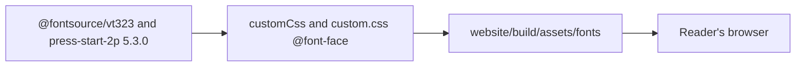

This PR restyles the documentation site in `website/` as a cosy 8-bit farming game, with day and night modes and self-hosted pixel fonts. It changes no page text, link or sidebar entry.

Verdict: Pending review. Blocking items: 0. Decisions needed: 1.

## Decisions needed

| Question | Options | Agent default | Consequence if unanswered |
| --- | --- | --- | --- |
| docs-site §7 still says colours go "only through the `--ifm-color-primary` variables on `:root` and `[data-theme='dark']`", but the theme uses `--px-*` palette tokens on `:root` and `html[data-theme='dark']` that feed the `--ifm` variables. Reword §7? | Reword §7 to match, or keep the wording | Keep the wording; not changed in this PR | §7 describes the colour setup less precisely than the CSS does. |

## Context

The site used the plain Docusaurus classic theme. This PR gives it a pixel-art farm look: a wooden navbar and buttons, parchment panels, pixel borders, dialogue-box admonitions and a home page with a pixel sky and farm, all drawn with CSS and inline SVG. Press Start 2P (headings, navbar, buttons) and VT323 (body text) load from pinned `@fontsource` packages and are served by the site itself. The user approved the pixel fonts, so docs-site §7 now allows them.

## Changes

| Task | Files | Behaviour change | Evidence id |
| --- | --- | --- | --- |
| Pixel farm theme (`6c89141`) | `website/src/css/custom.css`, `website/src/pages/index.tsx` | New day and night look; home page gains decorative sky, farm and card icons, with the copy unchanged | CHK-1 to CHK-5 |
| Self-hosted pixel fonts (`57dc4b6`) | `website/docusaurus.config.ts`, `website/package.json`, `website/package-lock.json`, `website/src/css/custom.css`, `.claude/skills/docs-site/SKILL.md` | Press Start 2P and VT323 served from the build; body text 22px; docs-site 1.4.0 allows the fonts | CHK-1 to CHK-7 |
| Describe the PR, with screenshots | `.agentville/pr/28/` | No runtime change | CHK-5 |

## Architecture changes

The two pinned fontsource packages feed the site build, which bundles the font files into the site's own assets. The browser loads them from the site, with no request to Google Fonts or another CDN.

## Tests and evidence

| Check | Command | Result | Evidence hash |
| --- | --- | --- | --- |
| CHK-1 Build | `cd website && npm ci && npm run build` | exit 0, no broken links | n/a |
| CHK-2 Audit | `cd website && npm audit` | 0 vulnerabilities | n/a |
| CHK-3 Typecheck | `cd website && npx tsc` | exit 0 | n/a |
| CHK-4 Contrast | WCAG luminance script, 22 text pairs and 5 admonition pairs per mode | all at least 4.5:1, lowest 4.54 | n/a |
| CHK-5 Layout | Playwright at 1280, 390 and 320px, light and dark | no horizontal scroll, 0 overflowing elements | n/a |
| CHK-6 Fonts | Playwright `document.fonts`, built CSS grep | VT323 and PressStart2P loaded; 0 off-site requests; no Google Fonts URL | n/a |
| CHK-7 Security | pre-publish gate, `--fail-on medium` | critical 0, high 0, medium 0; gate pass | n/a |

Not tested or not verifiable: Safari and Firefox rendering, a screen reader pass, and the live GitHub Pages deploy.

Screenshots: 56 full-page PNGs, covering all 14 pages of the built site (the 13 sitemap routes and the 404 page) in day and night, at desktop 1280px and mobile 390px. The [screenshot gallery](https://github.com/minhphamdonhat/Agentville/blob/{head-sha}/.agentville/pr/28/screenshots.md) holds one table per page, and the [screenshots folder](https://github.com/minhphamdonhat/Agentville/tree/ccr-fe3b21c9-3tt218/.agentville/pr/28/screenshots) holds the files. Home page preview:

| | Day | Night |
| --- | --- | --- |
| Desktop |  |  |
| Mobile |  |  |

## Risks, limits and rollback

VT323 has only one weight, so bold text is synthesised. The → arrow in some admonition titles falls back to the monospace font. The live site changes only after a docs tag the owner asks for. Roll back with `git revert -m 1 {merge-sha}` on `main`.

## Reviewer checklist

- [ ] VT323 body text at 22px reads comfortably, or Pixelify Sans should replace it.
- [ ] Press Start 2P headings and admonition titles are not too loud.
- [ ] The day and night palettes suit Agentville.
- [ ] The docs-site §7 amendment for self-hosted fonts is acceptable.

## Review verdicts

Pending: no reviewer has run yet.

## Evidence index

Head: {head-sha}

| Evidence | Where |
| --- | --- |
| Checks and limits | [Tests page](https://github.com/minhphamdonhat/Agentville/blob/{head-sha}/.agentville/pr/28/tests.md) |
| Screenshot gallery | [Gallery page](https://github.com/minhphamdonhat/Agentville/blob/{head-sha}/.agentville/pr/28/screenshots.md), one table per page |
| Screenshots | Folder `.agentville/pr/28/screenshots/` at `{head-sha}`, 56 PNG files for 14 pages, each 222 KB or less |

🤖 Generated with [Claude Code](https://claude.com/claude-code)
