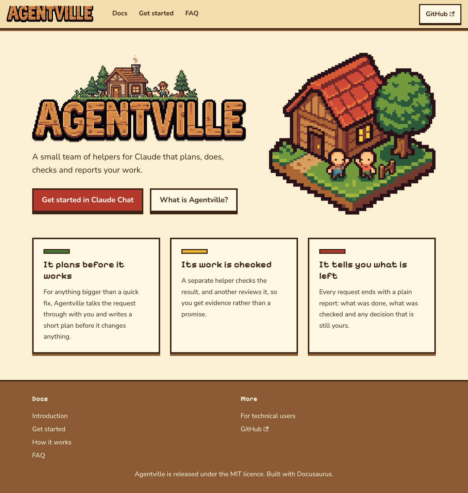
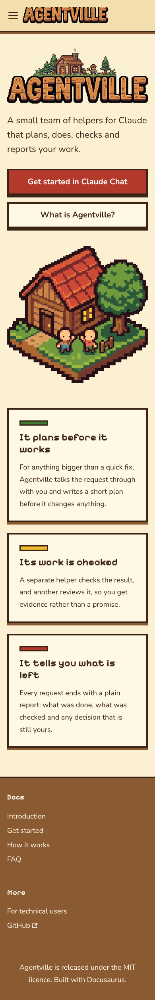
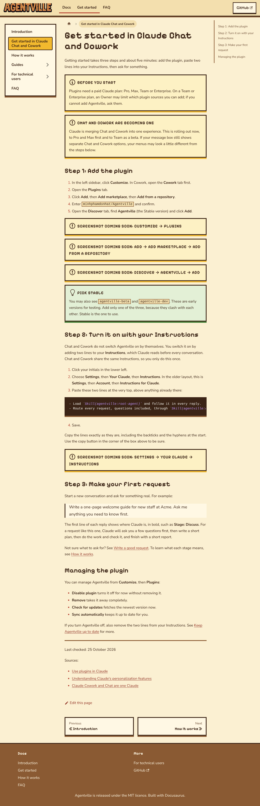
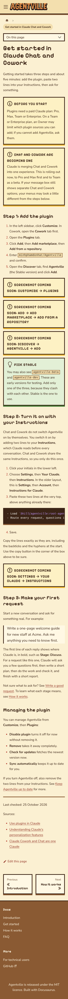
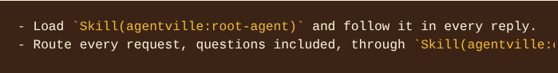

# Screenshot gallery

This page shows the new cosy 8-bit light theme: the home page and a docs page at desktop 1280px and mobile 390px, and one code block. The old pixel-farm screenshots (day and night themes) were removed because the theme they showed no longer exists.

The home and docs images come from validation run-1 at `26a3698`; the hero and layout are unchanged at `a59ca7b`. The code block image comes from validation run-2 at `a59ca7b`, after the palette code theme. They were captured with Playwright in Chromium from the built site. The originals and their hashes are in the local, untracked evidence folders `run-1` and `run-2` (`SHA256SUMS` hash `c83e164be079` and `93b0577481d9`).

## Home

Route: `/`. Files: `home-1280.png`, `home-390.png`.

| Desktop 1280px | Mobile 390px |
| --- | --- |
|  |  |

The hero shows the full wordmark above the isometric house, which is the open decision R5 in the PR body.

## Docs page

Route: a page under `/docs/`. Files: `docs-1280.png`, `docs-390.png`.

| Desktop 1280px | Mobile 390px |
| --- | --- |
|  |  |

## Code block

File: `codeblock-1280.png`, from run-2 at `a59ca7b`.

