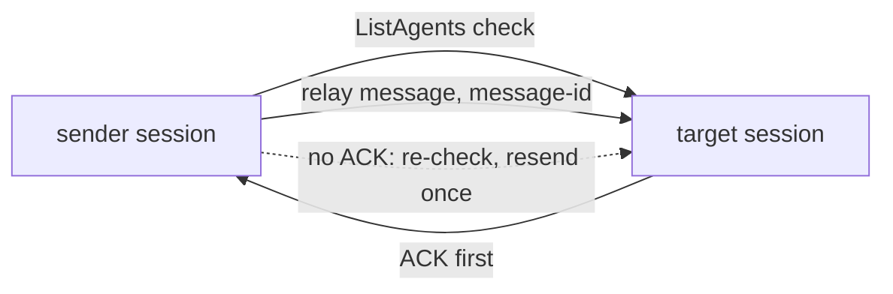

Adds the skill `agentville:intercommunicate` for messaging between persistent sessions with an ACK, and builds it into `pod-lead` and `root-agent`. It supersedes no earlier PR.

Verdict: Pending review. Blocking items: 0. Decisions needed: 1.

## Decisions needed

| Question | Options | Agent default | Consequence if unanswered |
| --- | --- | --- | --- |
| Run a live two-session ACK test and the with-skill vs baseline evals before merge? | Run them, or accept wording checks only | Accept wording checks only | Behaviour is checked by reading, not by a live run. |

## Context

Agents had no safe way to message a session that is not their parent or child. `intercommunicate` adds one: a plain relay `SendMessage` for own parent and child, and, across sessions, a `ListAgents` check, a relay-compiled message that needs an immediate ACK, and a resend rule. `pod-lead` gets constraint 9 and a "Message across sessions" workflow, and `root-agent` gets section 7.

## Changes

| Task | Files | Behaviour change | Evidence id |
| --- | --- | --- | --- |
| New skill (`ef224e7`) | `plugins/agentville/skills/intercommunicate/SKILL.md` | Cross-session messaging with ACK; plain relay for parent and child | run-4 |
| Relay for parent and child, no ACK timer (`0fd0060`) | same skill | No timer or `ScheduleWakeup` | run-4 |
| Awaiting-ack state and resume mode (`3bad2d3`) | same skill | Sender returns `partial` `awaiting-ack` with message-id, attempts and text; resumes in mode `await` | run-4 |
| Resume line carries the text (`7da0f7b`) | skill, `plugins/agentville/agents/pod-lead.md`, `plugins/agentville/skills/root-agent/SKILL.md` | Resume line holds the full message; pod-lead 1.5.0; root-agent 2.3.1 | run-4 |
| Review notes fixed (`83f14df`) | `plugins/agentville/skills/intercommunicate/SKILL.md`, `plugins/agentville/agents/pod-lead.md` | pod-lead 1.5.1 lists `delivery: sent (plain)` for own parent and child links, with Do and Don't; intercommunicate 1.2.2 step 6 resend rebuilds the step 4 header with the same message-id (Acme example `acme-web-rebase-2026-10-27-01`, Do and Don't) | run-5 |
| Registry (`ef224e7`) | `README.md`, `plugins/agentville/.claude-plugin/plugin.json` | README rows; plugin 0.11.0 | run-4 |

Behaviour in short:

* Own parent or child: plain `SendMessage` compiled with relay, no ACK.
* Cross-session, persistent sessions only; a spawned subagent returns `blocked`.
* No ACK: `ListAgents` re-check, one resend, then `blocked` and undelivered.
* The receiver ACKs first and re-ACKs a repeated message-id without redoing the work.

## Architecture changes

The sender checks the target, sends a relay message with a message-id and returns `awaiting-ack`. The receiver sends the ACK before it works. With no ACK the sender re-checks and resends once, then reports the message undelivered.

## Tests and evidence

| Check | Command | Result | Evidence hash |
| --- | --- | --- | --- |
| Skill and agent measure | `measure.py` (shipped and maintainer) on `intercommunicate/SKILL.md` and `pod-lead.md` | exit 0 | `41a94f94d54f` |
| Verify commands | the 8 commands under "Verify before you finish" in `CLAUDE.md` | all exit 0 | `41a94f94d54f` |
| Pre-publish gate | `scan.py --fail-on medium` with the project accepts | exit 0 (critical 0, high 0, medium 0) | `41a94f94d54f` |
| Versions and trailers | intercommunicate 1.2.2, pod-lead 1.5.1, plugin 0.11.0; one trailer, no session line; `origin` equals `83f14df` | confirmed | `41a94f94d54f` |

Not tested or not verifiable: a live two-session ACK run; with-skill vs baseline evals (not run); standalone eval cases were hand-run only, self-graded and are stale for mode `await`. These are wording checks only.

## Risks, limits and rollback

Known limit: an idle sender never declares a message undelivered, because there is no timer. The skill holds no timer on purpose. Roll back with `git revert -m 1 {merge-sha}` on `main`.

## Reviewer checklist

- [ ] The ACK-first rule and the one-resend rule suit how your sessions work.
- [ ] Leaving an idle sender without an undelivered verdict is acceptable.
- [ ] Plugin 0.11.0 is the right bump; it stays unreleased on this branch.
- [ ] The long resend sentence at `SKILL.md:111` may stay as one sentence or should be split in two.

## Review verdicts

Round 1: pass-with-notes. Round 2: needs-changes (no awaiting-ack state). Round 3: needs-changes (resume line lacked text; pod-lead bump level). Round 4: pass-with-notes (two wording notes, since fixed in `83f14df`). Round 5: pass-with-notes. Notes: the resend sentence at `SKILL.md:111` is a long chain and could be split in two; `plugin.json` stays 0.11.0 (unreleased on this branch).

## Evidence index

Head: {head-sha}

| Evidence | Where |
| --- | --- |
| Checks and reproduction | [Tests page](https://github.com/minhphamdonhat/Agentville/blob/{head-sha}/.agentville/pr/29/tests.md) |
| Validator evidence | Folder `run-5` at `83f14df` (runs 1 to 5 kept locally; 43 files sealed), `SHA256SUMS` hash `41a94f94d54f` |

🤖 Generated with [Claude Code](https://claude.com/claude-code)
