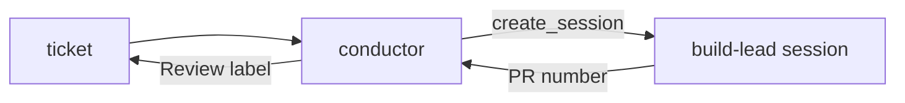

Add the shipped playbook-smith skill and the standalone conductor agent (plugin 0.13.0), the repository-only blueprint, build and lookout, and now one build-lead session per ticket. agent-smith (both copies, 2.1.0) forks from any base, and conductor starts a fresh build-lead session for each ticket in a cloud session.

Verdict: Pending review. Blocking items: 0. Decisions needed: 1.

## Decisions needed

| Question | Options | Agent default | Consequence if unanswered |
| --- | --- | --- | --- |
| Run `conductor` live in a cloud session before merge? | Run it first, or merge and watch the first run | Run it first | `create_session` parameters, build-lead tool loading and cloud detection stay unconfirmed. |

## Context

Conductor used to hand tickets to idle `pod-lead` sessions. It now starts one fresh session per ticket in a cloud session, named `<session-agent>-<ticket>-<UTC start>` with no cap; the repository steering sets `conductor: session-agent: build-lead`. agent-smith could only fork `worker`, so a fork of a standalone agent such as `pod-lead` needed a per-name exemption list. Both copies now read `metadata.base` and the list is gone.

## Changes

| Task | Files | Behaviour change | Evidence id |
| --- | --- | --- | --- |
| agent-smith forks from any base (`4dded05`) | `plugins/agentville/skills/agent-smith/`, `.claude/skills/agent-smith/` | `metadata.base` (worker by default); a standalone base's Constraints are copied verbatim and checked; A3 applies to every agent; `pod-lead` and `build-lead` are measured with `--allow-agent`. Version 2.1.0. | run-1 REQ-1 to REQ-3, run-2 REQ-1 to REQ-3 |
| conductor 1.0.0 (`4dded05`) | `plugins/agentville/agents/conductor.md` | One conductor at a time; cloud: one fresh session per ticket; local: an idle `pod-lead` or a blocker; `Review` label set after a fresh label read; tools add `create_session` and `issue_write`. | run-1 REQ-4, run-2 REQ-456 |
| build-lead, new (`4dded05`) | `.claude/agents/build-lead.md` | Fork of `pod-lead`: plans from the ticket, runs build, commits and pushes in cloud, opens the PR with `Closes #N` when none exists, reports the PR number to conductor. | run-1 REQ-5, run-2 REQ-456 |
| Steering and README (`4dded05`) | `CLAUDE.md`, `README.md` | Per-name exemption wording replaced by the base rule; `conductor: session-agent: build-lead` line. | run-2 REQ-456 |
| Earlier commits on this branch | `plugins/agentville/skills/playbook-smith/`, `.claude/skills/{blueprint,build,report}/`, `.claude/agents/lookout.md` | playbook-smith, blueprint and build; report skill renamed and cloud-only publishing; lookout and conductor flow updates. | see the commit list |

## Architecture changes

Conductor reads a ticket and starts a fresh build-lead session for it. Build-lead builds, commits, pushes and opens the PR, then sends the PR number to conductor. Conductor re-reads the ticket's labels and sets `Review`.

## Tests and evidence

| Check | Command | Result | Evidence hash |
| --- | --- | --- | --- |
| Validator run-1 | 6 requirements, REQ-1 to REQ-6 | 6/6 pass | `edb4842a9845` |
| Validator run-2 | 7 requirements, REQ-1 to REQ-7 | 7/7 pass | `33bf5005ffcd` |
| Four test scripts | `python3 {plugins/agentville,.claude}/skills/{agent-smith,skill-smith}/scripts/test_scripts.py` | 4 exit 0 | not hashed |
| Measure, conductor | `python3 plugins/agentville/skills/agent-smith/scripts/measure.py plugins/agentville/agents/conductor.md` | exit 0, failures none | not hashed |
| Measure, pod-lead | same script on `pod-lead.md` with `--allow-agent` | exit 0, failures none | not hashed |
| Measure, build-lead | `python3 .claude/skills/agent-smith/scripts/measure.py .claude/agents/build-lead.md --allow-agent` | exit 0, failures none | not hashed |
| Measure, agent-smith SKILL.md | skill-smith `measure.py` on both copies | exit 0, failures none | not hashed |
| Variants and worker copies | `python3 scripts/gen_agent_variants.py --check` and two `git diff --no-index --quiet` | exit 0 | not hashed |

Not tested or not verifiable: a live cloud run of conductor and build-lead.

## Risks, limits and rollback

`issue_write` can also close or retitle issues and is limited by rule only, a short race remains between the fresh label read and the write, and `eval.py` still grades against the worker report shape. Roll back with `git revert -m 1 {merge-sha}` on `main`. Detail: [risks page](https://github.com/minhphamdonhat/Agentville/blob/{head-sha}/.agentville/pr/31/risks.md).

## Reviewer checklist

- [ ] One fresh build-lead session per ticket with no cap suits the cloud budget.
- [ ] Granting conductor `issue_write`, limited by rule to the `Review` label, is acceptable.
- [ ] Plugin stays 0.13.0 and conductor 1.0.0 (kept by owner decision), although agent-smith moves to 2.1.0.
- [ ] Dropping the per-name exemption in favour of `--allow-agent` reads clearly in CLAUDE.md.

## Review verdicts

Round 1: needs-changes (versions, A3 skip, stale labels). Versions kept by owner decision ("Keep 0.13.0 & conductor at 1.0.0"), A3 restored, labels read fresh. Round 2: pass-with-notes; the notes are applied.

## Evidence index

Head: {head-sha}

| Evidence | Where |
| --- | --- |
| Checks and reproduction | [Tests page](https://github.com/minhphamdonhat/Agentville/blob/{head-sha}/.agentville/pr/31/tests.md) |
| Risks and limits | [Risks page](https://github.com/minhphamdonhat/Agentville/blob/{head-sha}/.agentville/pr/31/risks.md) |
| Validator evidence | Folders `run-1` (`SHA256SUMS` hash `edb4842a9845`) and `run-2` (`33bf5005ffcd`) in the local topic workspace, not committed |

🤖 Generated with [Claude Code](https://claude.com/claude-code)
