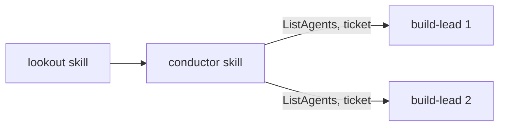

Conductor and lookout become repo skills loaded by `/conductor` and `/lookout`, and their agent files are deleted. `build-lead` stays a repo agent; this PR follows PR 33, which is merged.

Verdict: Pending review. Blocking items: 0. Decisions needed: 0.

## Decisions needed

none

## Context

Conductor and lookout are now repo skills in `.claude/skills/`, loaded by `/conductor` and `/lookout`. The `conductor` and `lookout` agent files are deleted; conductor never shipped, and the release is 0.12.0. `build-lead` stays a repo agent with `pod-lead`'s rules verbatim, runs `Skill(build)` instead of orchestrate, and at Report commits, pushes and opens or updates its PR automatically. The pipeline is lookout, then conductor, then several `build-lead` sessions: conductor hands each ticket to an idle `build-lead` found with `ListAgents`, or reports a blocker.

## Changes

| Task | Files | Behaviour change | Evidence id |
| --- | --- | --- | --- |
| Make conductor and lookout repo skills (`d8ecd90`) | `.claude/skills/conductor/`, `.claude/skills/lookout/` | Loaded by `/conductor` and `/lookout` | CHK-1 |
| Delete the agent files (`d8ecd90`) | `plugins/agentville/agents/conductor.md`, `.claude/agents/lookout.md` | Both agents removed | CHK-1 |
| Update `build-lead` (`d8ecd90`) | `.claude/agents/build-lead.md` | Runs `Skill(build)`, publishes its PR at Report | CHK-1 |
| Update docs and tests (`d8ecd90`) | `CLAUDE.md`, `README.md`, agent-smith tests | Steering and tables match the new layout | CHK-1 |
| Merge main (`b94f3f0`) | none | No tree change; main already held PR 33 | CHK-1 |

## Architecture changes

Lookout alerts conductor. Conductor hands each ticket to an idle `build-lead` found with `ListAgents`, or reports a blocker when none is idle.

## Tests and evidence

| Check | Command | Result | Evidence hash |
| --- | --- | --- | --- |
| Shipped agent-smith tests | `python3 plugins/agentville/skills/agent-smith/scripts/test_scripts.py` | OK | none |
| Shipped skill-smith tests | `python3 plugins/agentville/skills/skill-smith/scripts/test_scripts.py` | OK | none |
| Maintainer agent-smith tests | `python3 .claude/skills/agent-smith/scripts/test_scripts.py` | OK | none |
| Maintainer skill-smith tests | `python3 .claude/skills/skill-smith/scripts/test_scripts.py` | OK | none |
| Worker copies identical | `git diff --no-index --quiet` on both pairs | exit 0 | none |
| Variants | `python3 scripts/gen_agent_variants.py --check` | exit 0 | none |
| Security scan | `python3 .claude/skills/plugin-security/scripts/scan.py` with the accepted rules | exit 0 | none |

Not tested or not verifiable: a live conductor, lookout and `build-lead` run in separate sessions.

## Risks, limits and rollback

Sessions that relied on the deleted `conductor` or `lookout` agents must load the skills instead. Roll back with `git revert -m 1 {merge-sha}` on `main`.

## Reviewer checklist

- [ ] The conductor hand-off rule (idle `build-lead` or a reported blocker) reads clearly.
- [ ] `build-lead` publishing its PR at Report suits this repository.
- [ ] Deleting both agent files is acceptable.

## Review verdicts

Pending: the reviewer runs next.

## Evidence index

Head: {head-sha}

| Evidence | Where |
| --- | --- |
| Checks | Table above; no evidence run folder |

🤖 Generated with [Claude Code](https://claude.com/claude-code)
