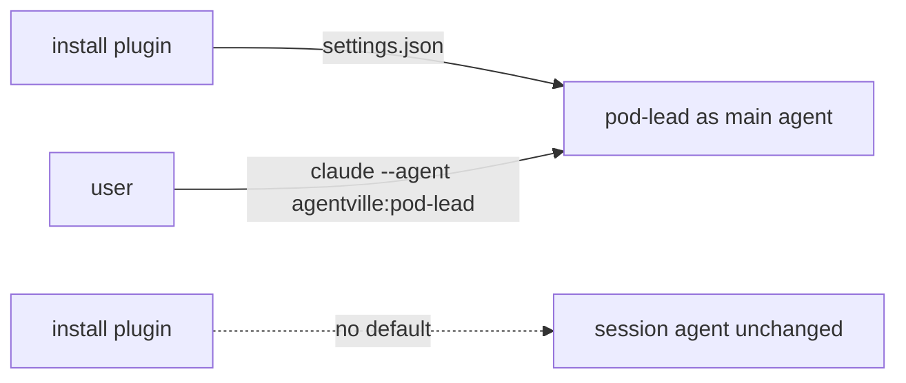

Removes the `build-lead` agent, the `lookout` skill and the plugin's `pod-lead` default, and moves the plugin to 1.0.0; installing no longer makes `pod-lead` the main agent. `pod-lead` itself stays shipped.

Verdict: Pending review. Blocking items: 0. Decisions needed: 2.

## Decisions needed

| Question | Options | Agent default | Consequence if unanswered |
| --- | --- | --- | --- |
| Rewrite the `conductor` skill and replace `build-lead`? | The owner rewrites it by hand, or plans it as a follow-up | Left to the owner; conductor will start build sessions with a system prompt to follow `Skill(build)` | `.claude/skills/conductor/` still names `build-lead` and `lookout` and does not work until rewritten. |
| Is `"agent": "agentville:pod-lead"` the right user setting? | Keep the namespaced form, or confirm the form against the Claude Code docs | Keep as written in README and website docs | The docs may show a setting Claude Code does not accept; unverified. |

## Context

The plugin shipped `settings.json` with `{"agent": "pod-lead"}`, so every install made `pod-lead` the main agent, and the maintainer-only `build-lead` and `lookout` supported a conductor flow built on that. The user chose to drop that default and those two parts. Users now run `pod-lead` with `claude --agent agentville:pod-lead` or an `agent` setting of their own. The repository's `CLAUDE.md` no longer imports `root-agent`.

## Changes

| Task | Files | Behaviour change | Evidence id |
| --- | --- | --- | --- |
| T1 Delete `build-lead` and `lookout`, remove references | `.claude/agents/build-lead.md`, `.claude/skills/lookout/`, `CLAUDE.md`, `.claude/skills/agent-smith/references/validate-rules.md`, `.claude/skills/agent-smith/SKILL.md` | Maintainer agent and skill gone; agent-smith 2.1.1 to 2.1.2 | V-CHK-1 |
| T2 Drop the plugin default, bump to 1.0.0 | `plugins/agentville/settings.json`, `plugins/agentville/.claude-plugin/plugin.json`, `README.md`, `website/docs/how-it-works.md`, `website/docs/technical/claude-code.md`, `website/docs/technical/index.md` | Breaking: installing no longer sets `pod-lead` as the main agent; docs explain `claude --agent agentville:pod-lead` | V-CHK-1 |
| T5 Update steering and README | `CLAUDE.md`, `README.md` | `root-agent` import removed | V-CHK-1 |
| Extra: website pages | `website/docs/` | Plan-adjacent doc edits, noted by the reviewer | V-CHK-1 |

T3 and T4 were dropped by the user.

## Architecture changes

Installing the plugin used to set `pod-lead` as the main agent through `settings.json`. That file is gone, so the main agent stays whatever the user chose. A user who wants `pod-lead` starts it with `claude --agent agentville:pod-lead` or sets `agent` in their own settings.

## Tests and evidence

| Check | Command | Result | Evidence hash |
| --- | --- | --- | --- |
| CLAUDE.md verify commands (8) | the 8 commands under Verify before you finish | all exit 0 | `ef189ef95d27` |
| Security scan | `python3 .claude/skills/plugin-security/scripts/scan.py` with the accepted rules | critical 0, high 0 | `ef189ef95d27` |
| Measure `pod-lead` and agent-smith | `measure.py` on both | exit 0 | `ef189ef95d27` |
| Removed paths absent | listing check | absent | `ef189ef95d27` |
| Version and import | read `plugin.json`, `CLAUDE.md` | version 1.0.0; `root-agent` import gone | `ef189ef95d27` |
| Leftover names | search | `build-lead` and `lookout` remain only in `.claude/skills/conductor/` | `ef189ef95d27` |

Not tested or not verifiable: the website build was not run; the namespaced `agent` setting is unverified against Claude Code docs.

## Risks, limits and rollback

This is a breaking change for installs that relied on `pod-lead` becoming the main agent, hence the major bump. The `conductor` skill is broken until it is rewritten. Roll back with `git revert -m 1 {merge-sha}` on `main`.

## Reviewer checklist

- [ ] A major bump to 1.0.0 is the right size for removing the default.
- [ ] The README and website wording for running `pod-lead` reads clearly (see the nit at `README.md:115`).
- [ ] Leaving `conductor` broken until the owner rewrites it is acceptable.
- [ ] The `agentville:pod-lead` agent setting should be confirmed against Claude Code docs.

## Review verdicts

Pass with notes, round 1. Notes: website edits are plan-adjacent; `conductor` still names `build-lead` and `lookout`; the namespaced agent setting is unverified; the website build was not run; nit on the lead-in wording at `README.md:115`.

## Evidence index

Head: {head-sha}

| Evidence | Where |
| --- | --- |
| Validator evidence | Folder `run-1` (kept locally, not committed), `SHA256SUMS` hash `ef189ef95d27` |

🤖 Generated with [Claude Code](https://claude.com/claude-code)
