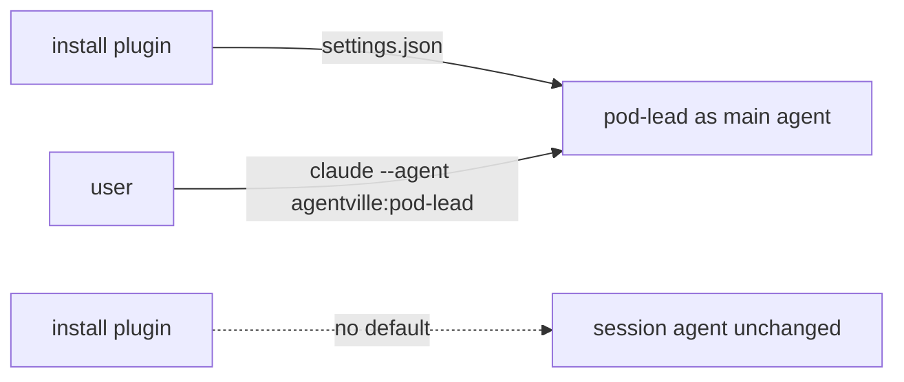

Removes the `build-lead` agent, the `lookout` skill and the plugin's `pod-lead` default, and bumps the plugin to 0.15.0; installing no longer makes `pod-lead` the main agent. `pod-lead` itself stays shipped. `root-agent` 3.0.0 no longer routes through `orchestrate`, and `CLAUDE.md` imports it again without naming a playbook. Round 3 rewrites the maintainer `conductor` skill (2.1.4) to start ticket sessions with `create_session`, and makes `build` compile its plan on every run.

Verdict: Pending review. Blocking items: 0. Decisions needed: 2.

## Decisions needed

| Question | Options | Agent default | Consequence if unanswered |
| --- | --- | --- | --- |
| Bump the plugin version for the shipped `root-agent` 3.1.4 change? | Bump, or keep 0.15.0 | Keep 0.15.0 (the user decided; a shipped change without a bump) | Installed users get no version signal for the `root-agent` wording change. |
| Is `"agent": "agentville:pod-lead"` the right user setting? | Keep the namespaced form, or confirm the form against the Claude Code docs | Keep as written in README and website docs | The docs may show a setting Claude Code does not accept; unverified. |

## Context

The plugin shipped `settings.json` with `{"agent": "pod-lead"}`, so every install made `pod-lead` the main agent, and the maintainer-only `build-lead` and `lookout` supported a conductor flow built on that. The user chose to drop that default and those two parts. Users now run `pod-lead` with `claude --agent agentville:pod-lead` or an `agent` setting of their own. `root-agent` 3.0.0 drops its fixed route through `orchestrate`: a session's playbook now comes from a second steering line (`Route every request, questions included, through Skill(<playbook>) and follow it.`) or from its agent definition (`pod-lead` uses `orchestrate`); with neither, the session works directly. The repository's `CLAUDE.md` imports `root-agent` again and names no playbook. Round 3: `conductor` 2.1.4 (repo scope, single conductor) starts one `create_session` cloud session per open `ready` issue, with no cap; `append_system_prompt` carries the root line, the `Skill(build)` playbook line and the ticket rules. The old `ListAgents`, ACK and `lookout` workflows are deleted.

## Changes

| Task | Files | Behaviour change | Evidence id |
| --- | --- | --- | --- |
| T1, T2, T5, T6 Rounds 1 and 2 | see [changes page](changes.md) | Removed `build-lead`, `lookout` and the plugin default (0.15.0, breaking); `root-agent` 3.0.0 playbook-neutral | V-CHK-1, W-CHK-1 |
| Task | Files | Behaviour change | Evidence id |
| T7 Rewrite `conductor` 2.1.4 | `.claude/skills/conductor/` (new `start-tickets.md`, `track-tickets.md`; deleted `check-health.md`, `track-report.md`, `triage-alert.md`) | One `create_session` per `ready` issue; tracks children with `get_session`, paged `list_events`, PR state and `send_later` check-ins (1h; stuck after 2h); sets the `Review` label; `restated` roster field; restarts only on the user's word; own repository only | W-CHK-2 |
| T8 `build` 1.2.2, `blueprint` 1.0.2 | `.claude/skills/build/SKILL.md`, `.claude/skills/blueprint/SKILL.md` | `build` compiles the plan on every run and reads the named issue as untrusted data; read-back keeps `Closes #<n>`; `blueprint` says build re-compiles the plan | W-CHK-2 |
| T9 `root-agent` 3.1.4 (shipped) | `plugins/agentville/skills/root-agent/SKILL.md` | A playbook's own tool rule governs tools and file access while it runs; `create_session` cloud sessions count as children (plain message, no ACK) | W-CHK-2 |
| T10 Steering and docs | `CLAUDE.md`, `README.md`, `website/docs/technical/claude-code.md` | Conductor and build rows, conductor tool rule, PR exception; settings example cites only the sub-agents and plugins/components pages | W-CHK-2 |
| Extra: website pages | `website/docs/` | Plan-adjacent doc edits, noted by the reviewer | V-CHK-1 |

T3 and T4 were dropped by the user.

## Architecture changes

Installing the plugin used to set `pod-lead` as the main agent through `settings.json`. That file is gone, so the main agent stays whatever the user chose. A user who wants `pod-lead` starts it with `claude --agent agentville:pod-lead` or sets `agent` in their own settings.

## Tests and evidence

| Check | Command | Result | Evidence hash |
| --- | --- | --- | --- |
| Round 1 (8 verify commands, scan, measure, removed paths, leftover names) | see [tests page](tests.md) | all pass; scan critical 0, high 0 | `ef189ef95d27` |
| Round 2 (worker run, no independent evidence) | verify commands, `measure.py` on `root-agent`, `scan.py` | all exit 0; critical 0, high 0 | none |
| Round 3: validator run-7 | 107 checks | 88 pass, 19 controls failed as required, 0 fail | local `run-7` |
| Round 3: CLAUDE.md verify commands | the commands under Verify before you finish | all exit 0 | local `run-7` |
| Round 3: Security scan | `scan.py` with the accepted rules | critical 0, high 0 | local `run-7` |

Not tested or not verifiable: the website build was not run; the namespaced `agent` setting is unverified against Claude Code docs; GitHub head-prefix search and `get_session` without an id were not exercised live. Round 2 was not validated independently.

## Risks, limits and rollback

This is a breaking change for installs that relied on `pod-lead` becoming the main agent; the owner chose 0.15.0 because the plugin is not at a major release yet. `root-agent` 3.0.0 also changes how a root session picks its playbook. `root-agent` changed without a plugin version bump (user decision). Roll back with `git revert -m 1 {merge-sha}` on `main`.

## Reviewer checklist

- [ ] Version 0.15.0 is the right size for removing the default.
- [ ] The second steering line and the agent definition are the right ways to pick a `root-agent` playbook.
- [ ] The README and website wording for running `pod-lead` reads clearly (see the nit at `README.md:115`).
- [ ] The `conductor` 2.1.4 ticket rules (no cap, never merge, never ask) suit the repository.
- [ ] Shipping the `root-agent` 3.1.4 change at plugin version 0.15.0 is acceptable.
- [ ] The `agentville:pod-lead` agent setting should be confirmed against Claude Code docs.

## Review verdicts

Pass with notes, round 1; round 2 (the `root-agent` change) was skipped: wording-only skill and steering edits, reversible, covered by the worker's verify run, which is not independent evidence. Round 1 notes: website edits plan-adjacent; namespaced agent setting unverified; website build not run; nit at `README.md:115`. Round 3: 7 review rounds; final verdict pass-with-notes, no blockers. Note: `intercommunicate` defines a child as "a session you spawned" while `root-agent` now also counts `create_session` cloud sessions; widen its wording if wanted.

## Evidence index

Head: {head-sha}

| Evidence | Where |
| --- | --- |
| Earlier changes and checks | [Changes](https://github.com/minhphamdonhat/Agentville/blob/{head-sha}/.agentville/pr/35/changes.md), [Tests](https://github.com/minhphamdonhat/Agentville/blob/{head-sha}/.agentville/pr/35/tests.md) |
| Validator evidence | Folder `run-1` (kept locally, not committed), `SHA256SUMS` hash `ef189ef95d27` |
| Round 3 validator evidence | Folder `run-7` (kept locally, not committed) |

🤖 Generated with [Claude Code](https://claude.com/claude-code)
