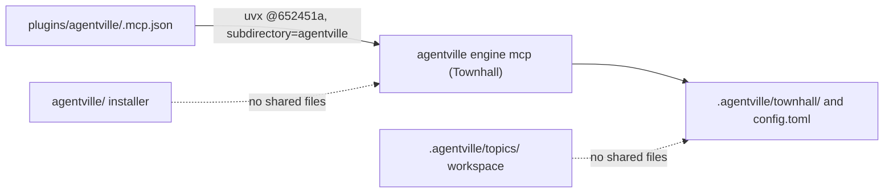

This PR adds the Townhall Python package in `townhall/`, starts its MCP server from the plugin through a SHA-pinned `uvx` launch, and brings the branch up to date with `main` by a merge commit. It supersedes #13.

## Goal

Ship Townhall, a file-based board-and-ticket engine for agents, beside `main`'s installer, and release it as plugin version 0.10.0. Townhall stays independent of `orchestrate` and of the `draft`, `plan` and `report` slots.

## Context

PR #13 added the package in `agentville/`, but `main` has since taken that folder for the installer CLI (`uvx agentville install`, PR #18). This branch merges `origin/main` (`5c0986f`) without squashing and moves Townhall to `townhall/`, so the two packages never share a folder. #13 stays open until this PR replaces it.

## Tasks done

The branch holds five commits: the package, the MCP pin, the docs, the merge with `main` and the move to `townhall/`. Each commit and what it changed is in the [task list](.agentville/pr/<PR_NUMBER>/tasks.md).

## Blockers

None.

## Architecture changes

The plugin launches the server from a pinned commit; the installer and the workspace sit beside it and share no files with it.

The package layout, the launch path and the boundaries are in the [architecture page](.agentville/pr/<PR_NUMBER>/architecture.md).

## Tests done and details

Every command under "Verify before you finish" in `CLAUDE.md` exits 0, including 277 Townhall tests, a clean `ruff check` and 38 root tests. The pre-publish gate (`--fail-on medium`) also exits 0. Commands, counts and how to reproduce them are on the [tests page](.agentville/pr/<PR_NUMBER>/tests.md).

## Risks and known limits

The main risks are the shared `agentville` package and console name, a pin that depends on an unsquashed merge, and a slow first start. The full list, with mitigations, is on the [risks page](.agentville/pr/<PR_NUMBER>/risks.md).

## Open decisions

Four decisions need the owner: the `townhall/` move, the shared package name, merging without squash, and the re-pin at the next release. Options and the current choice for each are on the [decisions page](.agentville/pr/<PR_NUMBER>/decisions.md).

## Review verdict

Pending: validator and reviewer run after this description; updated before review is requested.

## Evidence index

| Evidence | Where |
| --- | --- |
| Commits and per-commit changes | [Task list](.agentville/pr/<PR_NUMBER>/tasks.md) |
| Verify and gate results | [Tests page](.agentville/pr/<PR_NUMBER>/tests.md) |
| Diagrams and boundaries | [Architecture page](.agentville/pr/<PR_NUMBER>/architecture.md) |
| Risks and decisions | [Risks page](.agentville/pr/<PR_NUMBER>/risks.md), [decisions page](.agentville/pr/<PR_NUMBER>/decisions.md) |
| Superseded description | #13 |

🤖 Generated with [Claude Code](https://claude.com/claude-code)
