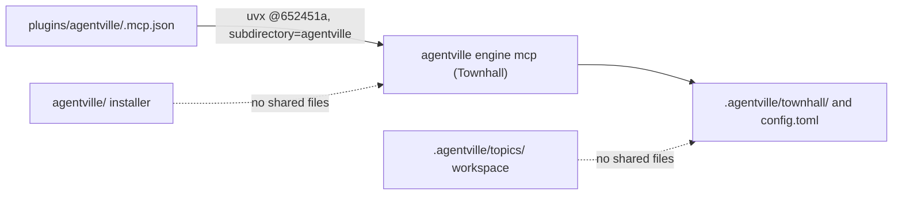

This PR adds the Townhall Python package in `townhall/`, starts its MCP server from the plugin through a SHA-pinned `uvx` launch, and merges `main` into the branch with a merge commit. It supersedes #13.

Verdict: Pending review. Blocking items: 0. Decisions needed: 4.

## Decisions needed

No item blocks the merge. These four choices need the owner; each row says what happens if nobody answers.

| Question | Options | Agent default | Consequence if unanswered |
| --- | --- | --- | --- |
| Where does Townhall live now that `main`'s installer holds `agentville/`? | Move Townhall to `townhall/`, or rename or move the installer | Move Townhall to `townhall/` (`138433f`) | The move ships; the installer stays as `main` has it. |
| Keep the shared `agentville` distribution and console name? | Keep both, or rename Townhall's to `townhall` | Keep both; `uvx` gives each its own environment | Installing both in one environment makes one console script replace the other. |
| Merge without squashing to keep the pin `652451a` reachable? | Merge commit, or squash and re-pin in a follow-up | Merge commit | A squash leaves `.mcp.json` pointing at a commit no branch keeps, so the server stops starting. |
| Re-pin with `subdirectory=townhall` at the next release? | Re-pin at 0.10.0, or keep `652451a` until a later release | Re-pin in the next release-preparation commit | The plugin keeps running Townhall as it was at `652451a`, before the move. |

Options and reasoning for each are on the decisions page, linked in the Evidence index.

## Context

Townhall is a file-based board-and-ticket engine for agents, released here as plugin version 0.10.0. PR #13 added it in `agentville/`, but `main` has since taken that folder for the installer CLI (`uvx agentville install`, PR #18). This branch merges `origin/main` (`5c0986f`) without squashing and moves Townhall to `townhall/`, so the two packages never share a folder. Townhall stays independent of `orchestrate` and of the `draft`, `plan` and `report` slots. #13 stays open until this PR replaces it.

## Changes

At `26c43c8` the diff against `main` (`git diff --stat origin/main...HEAD`) is 57 files, 12,633 insertions and 4 deletions; most of it is the new package and its lock file. Each row maps a change to the check that proves it.

| Task | Files | Behaviour change | Evidence id |
| --- | --- | --- | --- |
| Add the package (`652451a`) | `townhall/` (then `agentville/`) | New CLI, 11 `townhall_*` MCP tools, viewer and Temporal workflows | REQ-2-CHK-9, REQ-2-CHK-10 |
| Pin the MCP server (`f5577f2`) | `plugins/agentville/.mcp.json` | The plugin starts Townhall from `652451a` by full SHA | REQ-1-CHK-6 |
| Merge `main` (`5273bc9`) | `CLAUDE.md`, `README.md`, `plugin.json` | Keeps both sides; plugin version 0.10.0 | REQ-1-CHK-1, REQ-1-CHK-2, REQ-1-CHK-5 |
| Move to `townhall/` (`138433f`, `4471879`) | `townhall/`, `CLAUDE.md`, `README.md`, `.gitignore` | Townhall no longer shares a folder with the installer | REQ-2-CHK-9, REQ-2-CHK-11 |
| Describe the PR (`7a9125e`, `74dc5c1`, `26c43c8`) | `.agentville/pr/pending/` | No runtime change | REQ-3-CHK-1, REQ-3-CHK-4 |
| Record the PR folder (`26c43c8`) | `CLAUDE.md` | Adds an `.agentville/pr/` row to the layout table | Verify block, run-2 |

Two excerpts carry the decisions above. The pinned launch in `.mcp.json`:

https://github.com/minhphamdonhat/Agentville/blob/447187929322ddacb3a18ee3550a1ed8a559c3bd/plugins/agentville/.mcp.json#L5-L9

The shared console script in `townhall/pyproject.toml`:

https://github.com/minhphamdonhat/Agentville/blob/447187929322ddacb3a18ee3550a1ed8a559c3bd/townhall/pyproject.toml#L19-L20

Per-commit detail and the merge resolution are on the changes page, linked in the Evidence index.

## Architecture changes

The plugin's `.mcp.json` runs `uvx` at commit `652451a` with `subdirectory=agentville`, which starts the Townhall MCP server. The server reads and writes `.agentville/townhall/` and `.agentville/config.toml`. The installer in `agentville/` and the workspace in `.agentville/topics/` share no files with Townhall. The package layout and the launch sequence are on the architecture page, linked in the Evidence index.

## Tests and evidence

The validator ran every check at `26c43c8` (run-2) on Linux, in a clean clone where possible. All passed, and each control check failed as required.

| Check | Command | Result |
| --- | --- | --- |
| True merge of `main` | `git merge-base --is-ancestor origin/main HEAD` | Exit 0 |
| Pin reachable | `git merge-base --is-ancestor 652451a HEAD` | Exit 0 |
| Smith script tests (4 suites) | `python3 .../test_scripts.py` | 80, 84, 85 and 89 tests, OK |
| Townhall tests | `uv run --directory townhall pytest` | 277 passed, 0 skipped |
| Townhall lint | `uv run --directory townhall ruff check` | All checks passed |
| Installer tests | `uv run pytest` | 38 passed, 0 skipped |
| Pre-publish gate | `scan.py ... --fail-on medium` | 0 critical, high or medium |

Not tested or not verifiable: a live MCP launch from `.mcp.json`, a live Temporal run, any OS other than Linux, and `uv` older than 0.13.5. Commands and reproduction steps are on the tests page, linked in the Evidence index.

## Risks, limits and rollback

The main risks are the shared `agentville` package and console name, a pin that depends on an unsquashed merge, and a slow first start while `uvx` fetches Python 3.15. To roll back the whole PR, revert its merge commit on `main` with `git revert -m 1 <merge-sha>`. Reverting the move (`138433f`) on its own is not supported: it puts Townhall back in `agentville/`, where it collides with the installer. Mitigations are on the risks page, linked in the Evidence index.

## Reviewer checklist

- [ ] The `townhall/` move is the layout you want, rather than renaming the installer.
- [ ] Sharing the `agentville` distribution and console name with the installer is acceptable.
- [ ] You will merge with a merge commit, not a squash, so `652451a` stays reachable.
- [ ] Re-pinning with `subdirectory=townhall` at the next release fits the release plan.
- [ ] The README's Townhall section reads clearly to a new user.

## Review verdicts

Pending: reviewer runs next; this section is updated before review is requested.

## Evidence index

Head: <HEAD_SHA>

| Evidence | Where |
| --- | --- |
| Decisions | [Decisions page](https://github.com/minhphamdonhat/Agentville/blob/<HEAD_SHA>/.agentville/pr/<PR_NUMBER>/decisions.md) |
| Per-commit changes | [Changes page](https://github.com/minhphamdonhat/Agentville/blob/<HEAD_SHA>/.agentville/pr/<PR_NUMBER>/changes.md) |
| Diagrams | [Architecture page](https://github.com/minhphamdonhat/Agentville/blob/<HEAD_SHA>/.agentville/pr/<PR_NUMBER>/architecture.md) |
| Checks and reproduction | [Tests page](https://github.com/minhphamdonhat/Agentville/blob/<HEAD_SHA>/.agentville/pr/<PR_NUMBER>/tests.md) |
| Risks and rollback | [Risks page](https://github.com/minhphamdonhat/Agentville/blob/<HEAD_SHA>/.agentville/pr/<PR_NUMBER>/risks.md) |
| Validator evidence | Folder `run-2` at `26c43c8`, `SHA256SUMS` hash `810454535056` (run-1 at `4471879` is superseded) |

🤖 Generated with [Claude Code](https://claude.com/claude-code)
