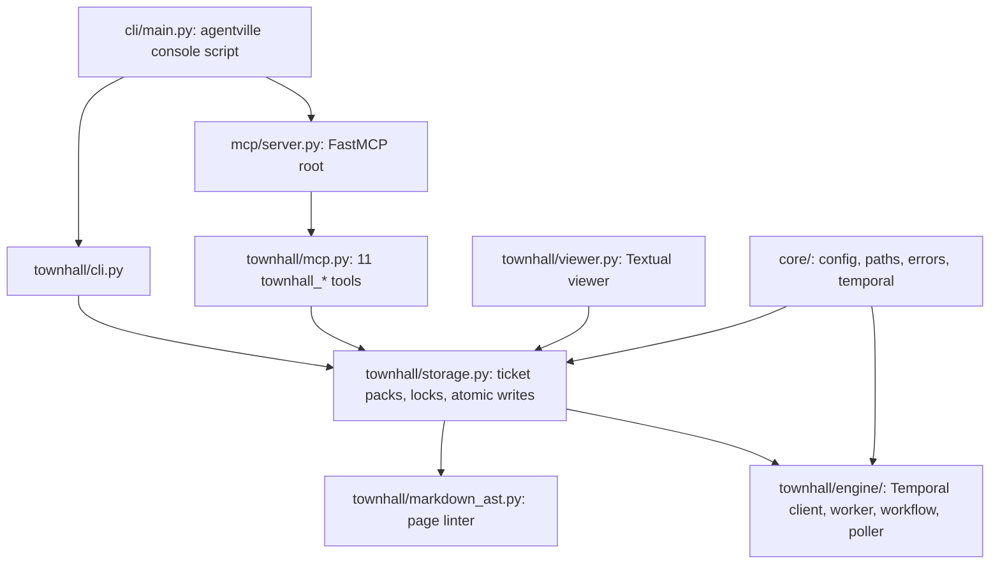
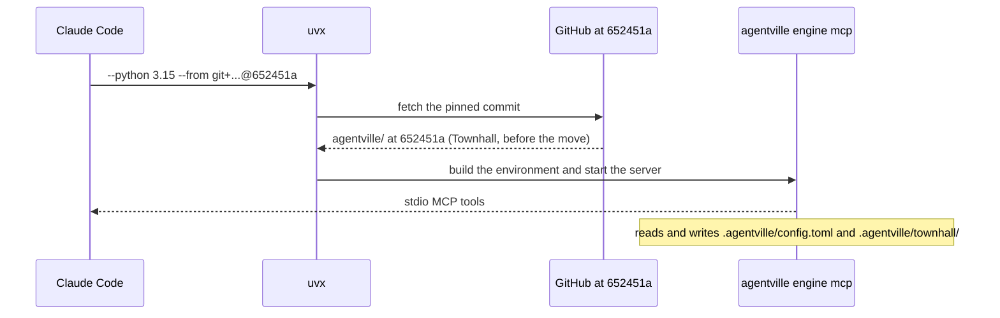
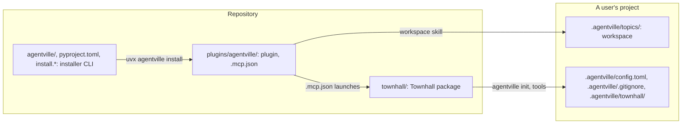

# Architecture changes

This page shows the Townhall package, the path from the plugin's `.mcp.json` to the running server, and how Townhall sits beside `main`'s installer and the workspace.

## Package layout

The package lives in `townhall/` with its own `pyproject.toml` and `uv.lock`. Its import package is `agentville`, so the code sits under `townhall/src/agentville/`. The `rag` and `memory` folders hold placeholder modules for later parts.

## MCP server launch path

Claude Code reads `plugins/agentville/.mcp.json` when the plugin loads. The server key is `agentville`, so the tools appear as `mcp__plugin_agentville_agentville__townhall_*`.

The pin uses `subdirectory=agentville` because `652451a` predates the move to `townhall/`. At that commit `agentville/` holds Townhall, not the installer. The next pin change switches the subdirectory to `townhall` in the same edit.

## Beside the installer and the workspace

Three parts share the repository and the project folder, and none reads another's files.

The installer and Townhall both publish the distribution name `agentville` and the console script `agentville`. The [decisions page](decisions.md) covers that choice.

## Boundaries

Townhall does not back `orchestrate` or the `draft`, `plan` and `report` slots, and they never read Townhall. The workspace writes only under `.agentville/topics/`; Townhall owns `.agentville/config.toml`, `.agentville/.gitignore` and `.agentville/townhall/`. Neither exists in this repository. Temporal is required for the lifecycle workflows: `agentville engine worker` starts a local dev server on first use, and the MCP server never starts it.
