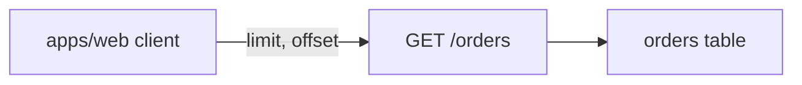

# Body template

The pull request body: a summary, the `Verdict:` line and nine H2 sections in a fixed order, at most 8000 characters. Detail that does not fit moves to the pages in [page templates](page-templates.md).

## Rules

* Open with one or two sentences that say what the PR does and what it supersedes, if anything.
* The `Verdict:` line reads `Verdict: {Pending review | Ready to merge | Changes requested}. Blocking items: {N}. Decisions needed: {N}.`
* Keep exactly the nine H2s below, in this order, and write `none` under any that has nothing.
* Decisions needed: a table `Question | Options | Agent default | Consequence if unanswered`. Blockers come first as rows whose Question starts `Blocker:`, and only when there are any; never a `## Blockers` heading.
* Context: merge the goal into it; two to five sentences, no code.
* Changes: a table `Task | Files | Behaviour change | Evidence id`, with commit SHAs in the Task cell, and at most two commit-SHA permalinks, each a bare URL on its own line (`https://github.com/{owner}/{repo}/blob/{40-char-sha}/{path}#L{a}-L{b}`).
* Architecture changes: one Mermaid block with `accTitle:` and `accDescr:` lines, then 2 to 4 lines of prose that say the same as the diagram; `none` when nothing structural changed.
* Tests and evidence: a table `Check | Command | Result | Evidence hash`, one row per check exactly as given, then one line starting `Not tested or not verifiable:`.
* Risks, limits and rollback: the main risks in one or two sentences and the rollback command, such as `git revert -m 1 {merge-sha}`.
* Reviewer checklist: 3 to 6 `- [ ]` boxes, each a judgement only a person can make; never a box a check already proves.
* Review verdicts: the review result as given, or `Pending` with what runs next.
* Evidence index: `Head: {head-sha}`, then a table `Evidence | Where` that links every page by `https://github.com/{owner}/{repo}/blob/{head-sha}/.agentville/pr/{number}/{page}.md` and names the evidence run folder and its `SHA256SUMS` hash.
* End with the line `🤖 Generated with [Claude Code](https://claude.com/claude-code)` and nothing after it.
* Never write a claude.ai link, a session id or a host path.

## Report names to sections

| Report field in `content` | Section it fills |
| --- | --- |
| Outcome | Summary sentences and the `Verdict:` line |
| Delivered | Changes |
| Evidence | Tests and evidence, Evidence index |
| Review | Review verdicts |
| Extra work | Changes (one row per item, Task starting `Extra:`) |
| Out of scope | Decisions needed |
| Open items | Decisions needed (a blocker or a decision) or Risks, limits and rollback (a known limit) |

## Template

````markdown
{One or two sentences: what this PR does, and which PR it supersedes, if any.}

Verdict: Pending review. Blocking items: 0. Decisions needed: 1.

## Decisions needed

| Question | Options | Agent default | Consequence if unanswered |
| --- | --- | --- | --- |
| Keep page size 50 for `GET /orders`? | 50, or 100 | 50 (`a1b2c3d`) | Clients keep 50 rows per page. |

## Context

The Acme orders endpoint in `apps/api` returned every order in one response. This PR adds `limit` and `offset` paging so the web client in `apps/web` can load one page at a time.

## Changes

| Task | Files | Behaviour change | Evidence id |
| --- | --- | --- | --- |
| Add paging (`a1b2c3d`) | `apps/api/src/orders.py` | `GET /orders` takes `limit` and `offset` | T1-CHK-1 |
| Describe the PR (`e4f5a6b`) | `.agentville/pr/42/` | No runtime change | T2-CHK-1 |

https://github.com/acme/acme/blob/a1b2c3d4e5f6a7b8c9d0e1f2a3b4c5d6e7f8a9b0/apps/api/src/orders.py#L12-L30

## Architecture changes



The web client sends `limit` and `offset` to `GET /orders`, which reads one page from the orders table.

## Tests and evidence

| Check | Command | Result | Evidence hash |
| --- | --- | --- | --- |
| Orders tests | `pytest apps/api/tests/test_orders.py` | 12 passed | `3c4d5e6f7a8b` |

Not tested or not verifiable: a live database larger than the fixture.

## Risks, limits and rollback

Clients that expect the full list now get 50 rows. Roll back with `git revert -m 1 {merge-sha}` on `main`.

## Reviewer checklist

- [ ] Page size 50 suits the web client.
- [ ] The new query parameters read clearly in the API docs.
- [ ] Rolling back by reverting the merge is acceptable.

## Review verdicts

Pending: the reviewer runs next.

## Evidence index

Head: {head-sha}

| Evidence | Where |
| --- | --- |
| Checks and reproduction | [Tests page](https://github.com/acme/acme/blob/{head-sha}/.agentville/pr/42/tests.md) |
| Validator evidence | Folder `run-1` at `a1b2c3d`, `SHA256SUMS` hash `9a8b7c6d5e4f` |

🤖 Generated with [Claude Code](https://claude.com/claude-code)
````
