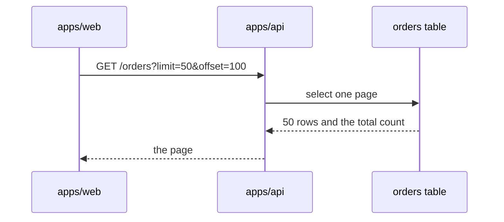

# Page templates

The detail pages beside `PR_BODY.md` in `.agentville/pr/{number}/`, or `.agentville/pr/pending/` before the PR has a number. Write a page only when its section has more than the body holds; link each page from the Evidence index by `{head-sha}`, and between pages by a relative link such as `[decisions page](decisions.md)`. Every page opens with an H1 and one sentence saying what it lists, uses repository-relative paths only, and holds no claude.ai link, session id or host path.

## decisions.md

```markdown
# Open decisions

This page lists the decisions the owner needs to make before or at merge. Each gives the current choice and the alternative.

## 1. Keep page size 50 for GET /orders

The current choice is 50 rows per page (`a1b2c3d`), because the web client renders 50 rows. The alternative is 100, which halves the requests for long lists.
```

## changes.md

```markdown
# Changes

This page lists the branch's commits against `main` and what each one changed. The diff is `git diff origin/main...HEAD`: 4 files, 120 insertions and 8 deletions at `e4f5a6b`.

| Commit | Subject | What it changed |
| --- | --- | --- |
| `a1b2c3d` | `feat(api): add paging to the orders endpoint` | Adds `limit` and `offset` to `GET /orders` in `apps/api/src/orders.py`. |
```

## architecture.md

````markdown
# Architecture changes

This page shows how a paged request flows from the web client to the database.



In words: the web client asks `GET /orders` for one page, and the API reads that page from the orders table and returns it with the total count.
````

## tests.md

````markdown
# Tests and evidence

This page lists every check the validator ran at `e4f5a6b` (evidence folder `run-1`, `SHA256SUMS` hash `9a8b7c6d5e4f`) and its result.

| Check | Command | Result |
| --- | --- | --- |
| Orders tests | `pytest apps/api/tests/test_orders.py` | 12 passed |

## How to reproduce

```bash
pytest apps/api/tests/test_orders.py -q
```

## Not tested or not verifiable

A live database larger than the fixture.
````

## risks.md

```markdown
# Risks, limits and rollback

This page lists the risks this PR brings and what limits or mitigates each one.

| Risk | Impact | Mitigation |
| --- | --- | --- |
| Clients expect the full list | They see 50 rows only. | The response carries the total count. |

## Rollback

* Whole PR: `git revert -m 1 {merge-sha}` on `main`.
```

## updates.md

```markdown
# Updates

This page lists each update to the PR after it was opened, newest last.

## Update (2026-10-18T09:30:00Z)

- Evidence run-2 at `f6a7b8c`: orders tests 14 passed.
```
