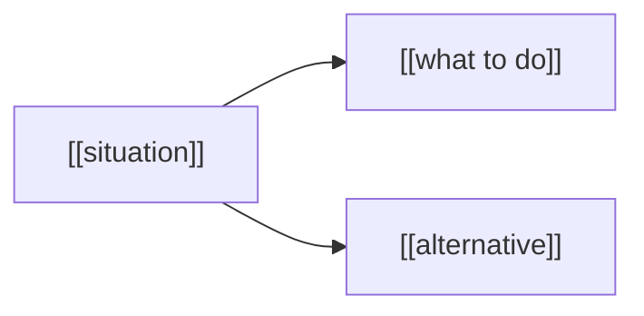

# [[skill-name]]

Goal: [[one sentence: the questions this skill answers and who loads it]]. Read the section whose title matches the topic you need. [[Sources: a relative link to a file in this skill's references/ folder, or an external URL; delete this sentence when there are none.]]

<!-- Keep this shape: one H1 equal to the name, one Goal line, numbered H2 sections from 1 with no gaps, then the closing Pre-send check of at least three items, each ending with (§N). One topic per section, titled as a reader would ask for it; every section holds ### Examples with at least two worked examples. No Role, Constraints, Input, Process or Output sections and no frontmatter key besides name and description. Never name a section Overview, Details, Misc, Introduction, Notes or Summary. Bulk data goes in references/<topic>.md with a relative link. The mermaid block is optional: delete it when it adds nothing the bullets do not. Name no file or skill outside this folder, and name nothing that runs this skill, because it must work when invoked alone. Delete every comment. -->

## 1. [[Topic 1]]

- [[Fact, stated as a full sentence with its key term first.]]
- [[Fact.]]

### Examples

- [[Worked example 1.]]
- [[Worked example 2, different from the first.]]

## 2. [[Topic 2]]

- [[Fact.]]
- [[Fact.]]

### Examples

- [[Worked example 1.]]
- [[Worked example 2.]]

## Pre-send check

Run each item before saving. The section holds the rule.

1. Each section title names one topic that can be asked for (§[[N]]).
2. Every fact is stated once, in the section that owns it, and is true at the source it cites (§[[N]]).
3. Each topic carries at least two worked examples that differ from each other (§[[N]]).
4. Every diagram is a fenced `mermaid` block that adds something the bullets do not (§[[N]]).
5. The skill states facts only: no steps or instructions to act (§[[N]]).
