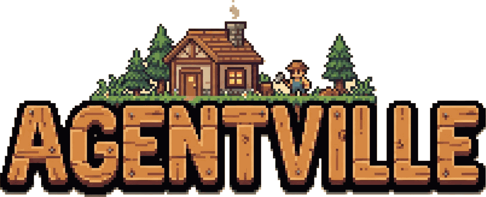

<p align="center"></p>

# Agentville

Agentville is a plugin of skills and agents for running work through agents: a playbook that triages each request and runs the stages it needs, a procedure that delegates one task at a time, writing standards for what agents and people read, standing rules for a delegating agent, and five swappable slots that each agent resolves for itself. It installs as one versioned unit; skills are namespaced `agentville:<skill>` and agents `agentville:<agent>`.

New to Agentville, or using it in Claude Chat or Cowork? The documentation site walks you through it in plain words: <https://minhphamdonhat.github.io/Agentville/>.

## Requirements

Agentville runs out of the box on Linux, macOS and Windows, on a laptop or a bare VPS, with Claude Code as the main platform.

* **Claude Code**, with the plugin installed as described below.
* **Git**, for the workspace's git-ignore check.
* **Python 3.8 or newer**, only for the helper scripts of `agent-smith`, `skill-smith` and the maintainer skills. They use the standard library alone. Run them as `python3` on Linux and macOS and as `py -3` (or `python`) on Windows.
* **A shell:** bash on Linux and macOS, PowerShell on Windows. Skills and agents write commands in that form and give a PowerShell form where the two differ. A project's `CLAUDE.md` or steering can name another shell, and that wins.

Nothing else is required. `rg`, `jq` and `gh` are optional: where an agent could use one, it uses Claude Code's own `Grep` and `Read` tools or a shell built-in when the tool is missing.

## Install

In Claude Code, add the marketplace once, then install one channel:

```text
/plugin marketplace add minhphamdonhat/Agentville
/plugin install agentville@minhphamdo
```

| Channel | Install id | Branch |
| --- | --- | --- |
| Release | `agentville@minhphamdo` | `release` |
| Beta | `agentville-beta@minhphamdo` | `beta` |
| Development | `agentville-dev@minhphamdo` | `main` |

Install one channel at a time: all three load the same names under `agentville:`, so two would clash. To switch, uninstall the one you have and install the other, for example `/plugin uninstall agentville@minhphamdo` then `/plugin install agentville-beta@minhphamdo`.

In Chat, open Customize, then Plugins, choose Add marketplace, enter `minhphamdonhat/Agentville` and install one channel.

From a terminal, the `agentville` command does the Claude Code install for you: it adds the marketplace, installs one channel and adds the two steering lines shown under [Three ways to run it](#three-ways-to-run-it) to `CLAUDE.md`. It needs [uv](https://docs.astral.sh/uv/) 0.13 or later and Python 3.15; uv downloads that Python when you do not have it. There are two ways to run it, and both take the same options.

### Install with uvx

`uvx` runs the latest published `agentville` without keeping it installed, and downloads Python 3.15 when it is missing:

```bash
uvx agentville install
uvx agentville install --scope project
uvx agentville install --channel beta
```

If your uv is older than 0.13, upgrade it to 0.13 or later (`uv self update`). Failing that, add `--python 3.15` after `uvx` to pick the Python by hand.

### Install the agentville command

The install script puts a persistent `agentville` command on your `PATH` with `uv tool install`, for your user only. When uv is missing, it downloads Astral's official uv installer, pinned to one uv version, to a temporary file and runs it; it asks first only when you run it at a terminal. It never uses `sudo` or administrator rights, and running it again upgrades the command.

On Linux and macOS:

```bash
curl --proto '=https' --tlsv1.2 -LsSf https://raw.githubusercontent.com/minhphamdonhat/Agentville/main/install.sh | bash
```

On Windows, in PowerShell:

```powershell
powershell -ExecutionPolicy ByPass -c "irm https://raw.githubusercontent.com/minhphamdonhat/Agentville/main/install.ps1 | iex"
```

On Windows, in the Command Prompt:

```bat
curl --proto "=https" --tlsv1.2 -fsSL https://raw.githubusercontent.com/minhphamdonhat/Agentville/main/install.cmd -o install.cmd && install.cmd && del install.cmd
```

Then open a new terminal, so that `PATH` includes the new command, and run `agentville install` with the options below.

Each script takes an optional version, `latest` by default, and a switch to install from the GitHub repository instead of PyPI:

```bash
curl --proto '=https' --tlsv1.2 -LsSf https://raw.githubusercontent.com/minhphamdonhat/Agentville/main/install.sh | bash -s 0.1.0
curl --proto '=https' --tlsv1.2 -LsSf https://raw.githubusercontent.com/minhphamdonhat/Agentville/main/install.sh | bash -s -- --from-source
```

```powershell
& ([scriptblock]::Create((irm https://raw.githubusercontent.com/minhphamdonhat/Agentville/main/install.ps1))) 0.1.0
& ([scriptblock]::Create((irm https://raw.githubusercontent.com/minhphamdonhat/Agentville/main/install.ps1))) -FromSource
```

Set `AGENTVILLE_NO_MODIFY_PATH=1` to leave `PATH` alone, and `AGENTVILLE_YES=1` (or pass `--yes`, in PowerShell `-Yes`) to skip the question at a terminal; nothing is asked when `CI` is set. Upgrade with `uv tool upgrade agentville` and remove the command with `uv tool uninstall agentville`.

### Installer options

| Option | Values | Default |
| --- | --- | --- |
| `--scope` | `user` (your home folder) or `project` (the current folder, or `--project-dir PATH`) | `user` |
| `--channel` | `stable`, `beta` or `dev`, the channels in the table above | `stable` |
| `--target` | `claude-code` | `claude-code` |
| `--dry-run` | Prints the actions and changes nothing | Off |

With the `claude` command on your `PATH`, the installer runs `claude plugin marketplace add` and `claude plugin install`. Without it, the installer writes the same marketplace and plugin entries into Claude Code's `settings.json` and keeps every other key; it refuses to touch a file that is not valid JSON. User scope writes `~/.claude/settings.json` and `~/.claude/CLAUDE.md`; project scope writes `.claude/settings.json` and `CLAUDE.md` in the project folder. A second run changes nothing. The exit code is 0 on success, 1 when a step fails and 2 for a usage error.

## Three ways to run it

In Claude Code, installing Agentville makes `pod-lead` the main agent by default, so `orchestrate` runs on every request. Chat and Cowork ignore plugin settings, so there you opt in. Pick one way:

1. **Chat.** Install the plugin through Customize, then put these lines at the top of your custom instructions:

   ```markdown
   - Load `Skill(agentville:root-agent)` and follow it in every reply.
   - Route every request, questions included, through `Skill(agentville:orchestrate)` and follow it.
   ```

2. **Claude Code with pod-lead as the main agent.** The plugin ships a `settings.json` with `{"agent": "pod-lead"}`, so an installed plugin makes `pod-lead` the main agent of every session. `pod-lead` runs every request through `orchestrate` and follows `root-agent`. To run it for one session only, start `claude --agent agentville:pod-lead`. Your own `agent` setting overrides the plugin's.

3. **Claude Code with another agent.** The documented ways to use an agent other than `pod-lead`:

   * Start one session with `claude --agent <name>`.
   * Name another agent in your own `agent` key in `~/.claude/settings.json`; it overrides the plugin's.
   * Disable the plugin with `claude plugin disable agentville@minhphamdo` (`claude plugin disable --help`: "Disable an enabled plugin"). Inferred, not documented: this drops its defaults along with its skills. No documented value unsets `agent` back to the built-in agent.

   To make that agent follow Agentville, add these lines to your project's `CLAUDE.md`:

   ```markdown
   - Load `Skill(agentville:root-agent)` and follow it in every reply.
   - Route every request, questions included, through `Skill(agentville:orchestrate)` and follow it.
   ```

   To use your own playbook, fork `orchestrate` into a new skill and name it in the second line.

### What loads where

| Part | Claude Code | Cowork | Chat |
| --- | --- | --- | --- |
| Skills | Yes | Yes | Yes |
| Agents | Yes | Yes | Ignored per the docs |
| `settings.json` (`agent`) | Yes | Ignored | Ignored |
| Hooks | Yes | Yes | Ignored |

Chat now shares Cowork's Agent tool and file writing in some accounts, so `dispatch` can still spawn there; when an `agentville:` agent type is missing, it falls back to `general-purpose`. `dispatch` spawns a variant such as `agentville:worker-sonnet-high` only when the session's Agent tool has no `effort` parameter; otherwise it spawns the base agent and passes model and effort, and a missing variant falls back to the base agent with the model passed and records `effort unenforced, variant missing`.

### Updates

In Claude Code, auto-update is off by default for third-party marketplaces. Run `claude plugin marketplace update minhphamdo` to refresh the listings, which leaves installed plugins as they are. Then run `claude plugin update agentville@minhphamdo` (or the channel you installed, such as `agentville-beta@minhphamdo`), or choose Update now in the Installed tab. A running session keeps the old version until you restart it or run `/reload-plugins`. In Chat, turn on Sync automatically for a github.com marketplace, or use Check for updates.

## Skills

Each skill is invoked as `/agentville:<name>`.

| Skill | Purpose |
| --- | --- |
| `/agentville:orchestrate` | Playbook that `pod-lead` runs on every request: triages each request, runs the stages it needs from Discuss, Plan, Execute, Validate, Review and Report, and sends every spawn through `dispatch`. |
| `/agentville:dispatch` | Takes one delegated task through sharpening, agent choice, model and effort routing, brief, spawn, report reading and failure handling. |
| `/agentville:root-agent` | Standing rules for an agent that routes every request through `orchestrate`: voice on every reply, the answer first, a fixed tool list with no file reads, file delivery that depends on the surface, full skill names, a live task list and one rule for messages to or from other sessions (listed target, ACK first, delivery stated only from an ACK). |
| `/agentville:relay` | Writing standard for text another agent reads, such as briefs, hand-backs and tool results; owns the report status tokens. |
| `/agentville:intercommunicate` | Sends a message to another session with delivery confirmation: checks the target with `ListAgents`, requires an immediate ACK, resends once and reports an undelivered message; also tells the receiver to ACK first. A session you spawned, or the one that spawned you, gets a plain `SendMessage` compiled with `relay` in either direction, with no ACK. |
| `/agentville:voice` | Writing standard for Markdown a person reads, such as chat replies, reports and document files. |
| `/agentville:intelligence-routing-model` | Picks the cheapest Claude tier and effort level that still succeeds. |
| `/agentville:power` | Sets or shows the session's power mode, `eco`, `balanced` (default) or `max`, only from `/power <mode>`, else from a `power: <mode>` line in the agent prompt, rules, project `CLAUDE.md` or custom instructions; the mode tunes model tier, effort, review and rounds. Suggests eco for Pro, balanced for Max 5x and max for Max 20x. |
| `/agentville:context-injection` | Resolves slots to the skills that fill them and owns the binding syntax and resolution order. |
| `/agentville:workspace` | Default for the `workspace` slot: a run's topic, artefacts and scratch folders. |
| `/agentville:draft` | Used by `orchestrate` only. Default for the `draft` slot: records a topic's notes, decisions and open points in rounds. |
| `/agentville:plan` | Used by `orchestrate` only. Default for the `plan` slot: records a topic's goal, tasks with done criteria, and approval as a record only. |
| `/agentville:report` | Used by `orchestrate` only. Default for the `report` slot: records a topic's outcome, evidence, review result, out-of-scope findings and open items. |
| `/agentville:toolbelt` | Default for the `toolbelt` slot: discovers which verification tools are present for the checks a task needs. Discovery only; no network probes. |
| `/agentville:skill-smith` | Creates, improves or converts a Claude skill, validates it and installs it to project or user scope. |
| `/agentville:agent-smith` | Compiles an agent as a fork of a base agent (the worker by default, or another base such as `pod-lead`), validates it, evals it against its base and installs it to project or user scope. |
| `/agentville:playbook-smith` | Builds a playbook, a request-level skill such as `orchestrate`; delegates the drafting and the install to `skill-smith`. |

## Agents

Each agent reads its role from a `<role>ROLE</role>` tag on the first line of the brief. `dispatch` picks the agent for each role.

| Agent | Purpose |
| --- | --- |
| `agentville:worker` | The base agent: implements, explores and drafts. Its scout workflow is local-only. It inherits every tool, MCP included (MCP web tools too), except those its `disallowedTools` list denies, such as built-in web search and fetch and root-only tools (planning, scheduling, messaging and spawn). |
| `agentville:scout` | Researches external questions with web search and fetch only; holds no file or shell tool. |
| `agentville:validator` | Proves a behaviour with independent checks and writes hashed evidence; never edits product code. |
| `agentville:reviewer` | Reviews a diff against a plan, read-only, and reads the validator's evidence when present. |
| `agentville:pod-lead` | Standalone lead, not a fork: runs every request through `orchestrate`, delegates all work and holds no edit, search or shell tool. |
| `agentville:conductor` | Standalone root agent, not a fork: project manager over ticket sessions. In a cloud session it starts one fresh session per ticket (`pod-lead` by default, or the agent the steering names with `conductor: session-agent`), and locally it hands the ticket to an idle `pod-lead` by message. It keeps a roster, ages tickets against a service level expectation, applies blocker policies, takes ticket alerts from any watcher session the steering names (this repository's `lookout` is maintainer-only) and sets the `Review` label on a ticket's issue when its session reports a pull request. Holds no `Agent` tool and never commits, pushes, opens or merges a pull request itself. |

Each base agent except `pod-lead` and `conductor` also ships in nine variants, one per model and effort pair, named `<base>-<model>-<effort>`, with model `haiku`, `sonnet` or `opus` and effort `low`, `medium` or `high`, such as `agentville:reviewer-opus-high`. That makes 36 variants across worker, validator, reviewer and scout. Each is a copy of its base agent with `model` and `effort` fixed in its frontmatter, generated by the maintainer script `scripts/gen_agent_variants.py`; do not edit a variant by hand. `dispatch` uses a variant only when the session's Agent tool has no `effort` parameter.

## Context injection

The jobs agents share, a place to write files, a set of check tools and the way a topic's draft, plan and report are recorded, are slots rather than fixed rules. The plugin ships a default skill for each slot, and you swap in your own by binding the slot in your steering. `context-injection` sets the binding syntax and the order in which bindings are found.

For example, to have every Agentville agent use your own QA tools, put this in your project's `CLAUDE.md`:

```markdown
## Context injection

toolbelt: Skill(acme:qa-tools)
```

In Chat, bindings in custom instructions do not count, and every slot uses the plugin default.

## Where agents write

Agents write only under `.agentville/topics/` in the project root:

```text
.agentville/topics/
  .gitignore                 # tracked: */evidence/, */*/artefacts/, */*/scratch/
  <topic-id>/                # topic documents: local, ignored by the root .gitignore
    evidence/run-<N>/        # validator evidence with SHA256SUMS: ignored
    <agent>/artefacts/       # what an agent keeps: ignored
    <agent>/scratch/         # throwaway files, deleted before the report: ignored
```

The workspace writes its `.gitignore` on first use when it is missing, and writes nowhere else in `.agentville/`.

## External dependencies

`skill-smith` calls `/skill-creator` for evals and description tuning, so install that skill alongside it if you want `skill-smith` to test what it drafts. Its helper scripts need Python 3 (see Requirements).

Both smiths install only to project scope (`.claude/` in the project) or user scope (`.claude/` in the home folder). They refuse any plugin folder, Agentville included, and the helper scripts enforce that.

## Licence

MIT, see [LICENSE](LICENSE).
